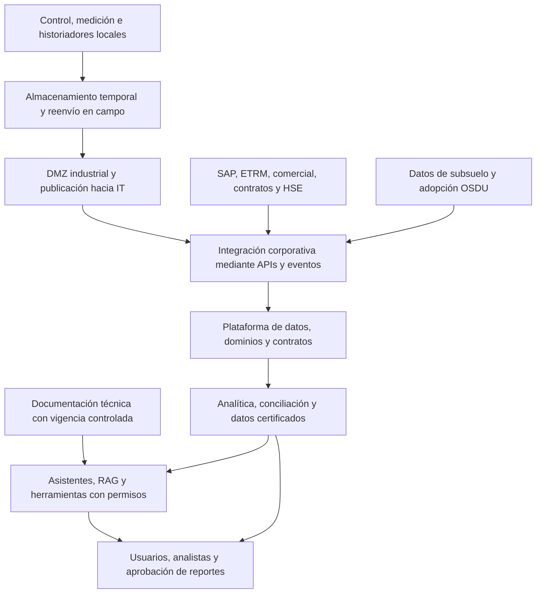

# Caso PetroAndes y contexto para Arquitectura de Integración

**Universidad de los Andes · Departamento de Ingeniería de Sistemas y Computación**  
**Asignatura:** ARTI 4212, Arquitectura de Integración.  
**Fuente primaria:** [ARTI4212_Caso_PetroAndes.pdf][Caso], 8 páginas.  
**Fecha de consolidación:** 31 de octubre de 2026.  
**Propósito:** conservar el contexto del caso para futuras consultas, análisis de problemas, diseño de arquitecturas y preparación de las entregas del proyecto.

Se revisaron las ocho páginas, incluida la tabla de magnitudes. PetroAndes y sus cifras son **ficticias y de uso pedagógico**. Las referencias [C1] a [C8] corresponden a las páginas físicas del PDF. Este archivo distingue los hechos y aspiraciones expresados por el caso de las implicaciones o preguntas derivadas del análisis.

El documento complementa [contexto_arquitectura_integracion.md][Contexto], que consolida las clases. Los requisitos descritos aquí proceden del caso; los ejemplos de clase o posibles soluciones no se convierten en hechos de la empresa. Las referencias regulatorias se conservan según el relato académico, sin una verificación externa de su vigencia o aplicación jurídica.

## Índice

1. [Resumen ejecutivo](#1-resumen-ejecutivo)
2. [Perfil de la compañía y cadena de valor](#2-perfil-de-la-compañía-y-cadena-de-valor)
3. [Pilares estratégicos](#3-pilares-estratégicos)
4. [Magnitudes y metas del caso](#4-magnitudes-y-metas-del-caso)
5. [Ecosistema tecnológico actual](#5-ecosistema-tecnológico-actual)
6. [Convergencia IT y OT y restricciones](#6-convergencia-it-y-ot-y-restricciones)
7. [Procesos de negocio](#7-procesos-de-negocio)
8. [Actores y relaciones externas](#8-actores-y-relaciones-externas)
9. [Motivadores del cambio](#9-motivadores-del-cambio)
10. [Analítica e inteligencia artificial](#10-analítica-e-inteligencia-artificial)
11. [Estado objetivo declarado](#11-estado-objetivo-declarado)
12. [Implicaciones para la arquitectura](#12-implicaciones-para-la-arquitectura)
13. [Alcance y entregas del proyecto](#13-alcance-y-entregas-del-proyecto)
14. [Información pendiente y reglas de reutilización](#14-información-pendiente-y-reglas-de-reutilización)
15. [Conclusiones y glosario](#15-conclusiones-y-glosario)
16. [Mapa de fuentes](#16-mapa-de-fuentes)

## 1 Resumen ejecutivo

PetroAndes S.A. es una compañía ficticia de energía e hidrocarburos, integrada verticalmente, con mayoría accionaria estatal y acciones en bolsa. Opera exploración y producción, transporte mediante AndesTransporte, dos refinerías y comercialización de combustibles. Su actividad es relevante para el abastecimiento nacional y la generación de recursos fiscales. El caso abarca una operación extensa: 5.400 pozos activos, 9.000 km de ductos, más de 350 sistemas de información y más de 400.000 señales en historiadores. ([C1]; [C8]).

El problema central es la fragmentación de un ecosistema que creció por proyectos, asociaciones y adquisiciones. Los sistemas resuelven necesidades por segmento, pero el intercambio entre ellos depende de planillas, archivos, correos y conciliaciones manuales. El BI recibe información con días o semanas de retraso. Las consecuencias aparecen en cinco procesos: liquidación de contratos y regalías; nominación y balance de transporte; planeación de refinación y abastecimiento; facturación y FEPC; e inventario de emisiones y gestión HSE. ([C2]–[C6]).

Los impactos son de negocio: detección de pérdidas semanas después de ocurridas, reclamaciones de remitentes que tardan meses, reprocesos regulatorios, esfuerzo dedicado a reportes, inventarios de seguridad excesivos y riesgo de desabastecimiento. La información técnica dispersa también dificulta identificar el procedimiento vigente. La transformación debe sostener la caja del negocio tradicional mientras habilita gas, hidrógeno, renovables y descarbonización con datos verificables. ([C4]–[C7]).

La estrategia tecnológica contempla migrar sistemas corporativos y plataforma de datos a nube pública, manteniendo control e historiadores en sitio. La publicación de información OT debe cruzar la DMZ industrial y conservar almacenamiento temporal y reenvío ante conectividad intermitente. La política del caso prohíbe escrituras directas desde sistemas corporativos o nube sobre el control industrial. La dirección también plantea lakehouse con dominios y contratos de datos, adopción de OSDU para subsuelo y una capa de APIs y eventos gobernada como producto interno. Son orientaciones objetivo, no capacidades plenamente desplegadas. ([C3]; [C6]–[C7]).

El portafolio de IA incluye asistentes para ingenieros, conciliación volumétrica, RAG técnico, borradores regulatorios y copilotos de operación. Su habilitador común es una integración gobernada: herramientas con permisos y auditoría, documentos vigentes, productos de datos certificados y aprobación humana antes de enviar reportes. Los copilotos consultan datos OT publicados y de solo lectura. ([C7]).

**Conclusión del análisis:** la oportunidad consiste en convertir datos dispersos en evidencia oportuna y confiable para operar, conciliar y decidir. El proyecto debe escoger una problemática delimitada, diseñar su blueprint y contratos, y justificar posteriormente el footprint, la implementación, el gobierno y los costos. La capa agéntica se incorpora si aplica al problema seleccionado. ([C8]).

## 2 Perfil de la compañía y cadena de valor

### 2.1 Identidad y presencia

El caso define a PetroAndes como una empresa ficticia de energía e hidrocarburos con participación mayoritaria del Estado colombiano, listada en bolsa y con sede principal en Bogotá. Tiene operaciones en Llanos Orientales, Magdalena Medio, Catatumbo, Putumayo y costa Caribe. La introducción indica presencia en más de 400 municipios y la tabla final precisa **416 municipios**. ([C1]; [C8]).

Su función económica incluye suministro nacional de combustibles líquidos y una porción creciente de la demanda de gas, así como contribuciones fiscales mediante regalías, dividendos e impuestos. La infraestructura industrial es moderna en varios activos, pero esto convive con deuda tecnológica y falta de cohesión entre sistemas.

### 2.2 Segmentos de la cadena

| Segmento | Actividad y activos del relato | Relaciones relevantes |
| --- | --- | --- |
| Upstream | Exploración y producción de crudo y gas; campos, pozos y subsuelo | ANH, socios de asociación y joint ventures, puntos de fiscalización |
| Midstream | Transporte por oleoductos y poliductos mediante AndesTransporte | Productores, remitentes, refinerías, puertos y plantas mayoristas |
| Downstream industrial | Refinación en Magdalena y Caribe, con petroquímica básica asociada | Upstream, trading, mantenimiento, transporte y comercial |
| Comercialización y distribución | Venta de combustibles a mayoristas y red aliada de estaciones | Terminales, medición fiscal, SAP, FEPC, DIAN y clientes |
| HSE y transición energética | Seguridad, ambiente, emisiones y nuevos proyectos energéticos | Todas las operaciones, mantenimiento, proveedores de medición, autoridades y comunidades |

La separación de HSE y transición como una fila es una forma de organizar el contexto transversal; el caso no describe cinco empresas independientes ni una estructura societaria completa. AndesTransporte sí se identifica expresamente como filial. ([C1]–[C5]).

## 3 Pilares estratégicos

El documento establece cuatro pilares. Las consecuencias sobre integración de la última columna son una lectura analítica de lo descrito. ([C1]–[C2]).

| Pilar | Contenido explícito | Consecuencia para la integración |
| --- | --- | --- |
| Sostenibilidad del negocio tradicional | Reposición de reservas, continuidad de producción, transporte y refinación; la caja tradicional financia la transformación | Conectar producción fiscalizada, contratos, liquidación y operación para proteger ingresos y eficiencia |
| Transición energética | Reducción de emisiones, carbono-neutralidad, gas, hidrógeno verde y azul, renovables, CCUS, metano y flaring | Producir información verificable de emisiones, atributos ambientales y desempeño por activo |
| Journey to Cloud y datos como activo | Centro de datos al límite, nube pública, OSDU, analítica e IA | Diseñar una arquitectura híbrida con intercambio gobernado entre fuentes locales y capacidades corporativas |
| Excelencia HSE y relación con el territorio | Seguridad de procesos, salud, licencias, agua, biodiversidad y comunidades; amenazas sobre los ductos | Relacionar datos operativos, incidentes, mantenimiento y evidencia ambiental con trazabilidad |

Las metas declaradas son reducir **25 % de CO2e de alcances 1 y 2 a 2030, con base 2019**, alcanzar **carbono-neutralidad en 2050 para alcances 1 y 2** y desarrollar una **meta de 900 MW renovables**. El caso incluye eliminación de quema rutinaria en teas y reducción de metano bajo OGMP 2.0. ([C1]; [C8]).

## 4 Magnitudes y metas del caso

Todos los valores siguientes proceden de la tabla de la página 8. Se conservan las unidades y los calificadores del PDF. Son magnitudes pedagógicas de la compañía ficticia, no estadísticas verificadas de una empresa real. ([C8]).

| Aspecto | Cantidad indicada |
| --- | --- |
| Producción total de crudo y gas | 746 kbped |
| Reservas probadas 1P | 1.900 MBPE |
| Vida media de reservas R/P | 7,6 años |
| Índice de reposición de reservas | 104 % |
| Pozos productores activos | 5.400 |
| Red de ductos de AndesTransporte | 9.000 km |
| Volumen transportado | 1.119 kbd |
| Capacidad Refinería del Magdalena | 250 kbpd |
| Capacidad Refinería del Caribe | 165 kbpd |
| Carga combinada de refinación | 414 kbd |
| Plantas de abastecimiento y terminales | 27 |
| Remitentes terceros de transporte | 35 |
| Estaciones de servicio de la red aliada | 2.000 |
| Municipios con presencia | 416 |
| Empleados directos | 19.000 |
| Empleos de contratistas | 88.000 |
| Señales o tags en historiadores | Más de 400.000 |
| Sistemas de información inventariados | Más de 350 |
| Emisiones CO2e de alcances 1 y 2 | 13,7 MtCO2e/año |
| Meta de reducción a 2030, base 2019 | 25 % |
| Meta de carbono-neutralidad de alcances 1 y 2 | 2050 |
| Capacidad renovable objetivo | 900 MW |
| Puntos de medición fiscal o custody transfer | Más de 300 |
| Válvulas ilícitas halladas en el último año del relato | Más de 400 |

### Precauciones de interpretación

- Capacidad de cada refinería y carga combinada son variables diferentes; la carga de 414 kbd no debe sustituirse por la suma de capacidades.
- Los 900 MW son una meta, no capacidad instalada confirmada.
- La tabla no identifica el año de las emisiones de 13,7 MtCO2e/año ni entrega el inventario de la línea base 2019. No corresponde aplicar automáticamente el 25 % sobre 13,7 para obtener la meta absoluta.
- El último año del indicador de válvulas ilícitas no tiene una fecha calendario explícita. La fecha de este resumen no fecha los hechos del caso.
- El número de tags no define una frecuencia de muestreo, tasa de eventos, tamaño de mensaje o volumen diario.
- Producción, transporte, reservas y refinación se conservan con las unidades del PDF; una conversión o comparación posterior debe declarar sus convenciones y supuestos.

## 5 Ecosistema tecnológico actual

### 5.1 Diagnóstico general

La infraestructura creció durante décadas mediante exploración, asociaciones y adquisiciones. Los sistemas están aislados por segmento, son costosos de mantener para la DTI y acumulan deuda que encarece proyectos nuevos. La mayoría de los sistemas de información se aloja on-premises en un centro de datos centralizado que llegó a su capacidad máxima. ([C2]).

Un consultor recomendó un segundo centro de datos. La compañía considera la nube como alternativa y el apartado de motivadores describe Journey to Cloud como estrategia definida para sistemas corporativos y plataforma de datos. El control industrial mantiene necesidades locales de latencia, seguridad y continuidad. ([C2]; [C6]–[C7]).

### 5.2 Tecnología de operación y sistemas cercanos a planta

El PDF agrupa los siguientes elementos bajo OT. Los productos citados como tipo o ejemplo indican una familia tecnológica y no prueban una contratación o versión específica. ([C2]).

| Sistema o capacidad | Responsabilidad y datos | Particularidad del caso |
| --- | --- | --- |
| SCADA | Supervisión y adquisición en campos y ductos | Proveedores distintos según época del proyecto |
| DCS | Control distribuido en las dos refinerías | Heterogeneidad industrial |
| Historiadores, tipo AVEVA PI System | Series de presión, temperatura, caudal y estados de equipos | Cada refinería y distrito opera el suyo, con nombres de tags diferentes |
| MES | Programación detallada de unidades, movimientos entre tanques y balance de planta | Un sistema por cada refinería en los procesos descritos |
| Custody transfer | Medidores fiscales, computadores de flujo, gestión y certificación de mediciones | Los certificados alimentan facturación entre segmentos y con terceros |
| Automatización de terminales | Cargaderos de carrotanques y terminales marítimos | Conecta ejecución física de entregas con operación comercial |
| Gestión de subsuelo, tipo Petrel/Eclipse | Sísmica, registros, modelos geológicos y simulación de yacimientos | Repositorios dispersos; adopción de OSDU iniciada |
| EAM/CMMS, tipo IBM Maximo | Órdenes, planes, mantenimiento y confiabilidad | Bombas, compresores, hornos y unidades críticas |
| LIMS | Ensayos y certificados de calidad de crudos y baches | Alimenta transporte, planeación y refinación |
| Pilotos de gemelos digitales | Unidades críticas de la Refinería del Caribe | Resultados mixtos por calidad e integración de datos |

**OSDU Data Platform** aparece como una adopción iniciada para consolidar y exponer datos de subsuelo por APIs estándar. Esto no demuestra que todos los datos estén ya consolidados ni que OSDU resuelva toda la plataforma corporativa.

### 5.3 Sistemas corporativos

| Sistema | Función y datos | Situación o dependencia descrita |
| --- | --- | --- |
| SAP IS-Oil | Finanzas, materiales, comercial, gestión de hidrocarburos HPM, regalías y contabilidad JVA | Registra liquidaciones y participa en conciliaciones |
| ETRM | Exportación de crudo, compras de crudo, importación de productos y riesgo de precio | Aporta precios a planeación y coordina abastecimiento |
| Nominaciones y balance de AndesTransporte | Capacidad solicitada, programas de bombeo y balance mensual por tramo | Recibe muchas planillas y archivos de operadores |
| Gestión comercial de combustibles | Pedidos, cupos, facturación mayorista, precios y posiciones FEPC | Requiere conciliar información comercial y física |
| Gestión HSE y emisiones | Incidentes, permisos de trabajo e inventario GEI | Inventario armado trimestralmente en hojas de cálculo |
| Canales web y móviles | Portal de remitentes, portal de mayoristas, app de campo y web corporativa | App de campo con conectividad intermitente |
| BI y analítica | Consolidación de información de facturación, custody transfer, SAP e historiadores | Extracciones manuales y archivos planos; rezago de días o semanas |
| Sistema documental jurídico | Contratos y condiciones de E&P y socios | Su papel se detalla en el proceso 1 y exige conciliación con medición y SAP |

Fuentes: [C3]–[C4]. El inventario es descriptivo: no especifica todas las interfaces, versiones, esquemas, mecanismos de autenticación ni propietarios de cada dato.

## 6 Convergencia IT y OT y restricciones

### 6.1 Segmentación de referencia

El caso organiza la arquitectura con Purdue e ISA-95 y describe ciberseguridad basada en IEC 62443 mediante zonas y conductos. La siguiente es la representación específica del documento. ([C3]).

| Nivel del caso | Sistemas o responsabilidad |
| --- | --- |
| 0 a 2 | Instrumentación y control |
| 3 | MES e historiadores |
| 3.5 | DMZ industrial para publicación hacia IT |
| 4 a 5 | Sistemas corporativos y capacidades de nube |

Purdue, ISA-95 e IEC 62443 se conservan como referencias relacionadas con funciones diferentes; la tabla no pretende describir de forma exhaustiva esos marcos.

### 6.2 Restricciones explícitas

1. **Sin escritura directa al control:** por política, los sistemas corporativos y de nube no escriben directamente sobre sistemas de control.
2. **Cruce por DMZ:** la información operativa se publica al entorno IT mediante la DMZ industrial.
3. **Permanencia local:** la estrategia mantiene control e historiadores en sitio por latencia, seguridad y continuidad.
4. **Desconexión remota:** el enlace satelital es intermitente; se necesitan edge, almacenamiento temporal y reenvío.
5. **Copilotos de solo lectura:** el acceso agéntico a datos OT se realiza sobre información publicada a través de la DMZ.
6. **Identidad y mínimo privilegio:** el portafolio de IA explicita identidad no humana, permisos por herramienta, auditoría y mitigación de prompt injection.
7. **Envío regulatorio aprobado:** los agentes preparan borradores y requieren aprobación humana antes del envío.

Fuentes: [C3]; [C6]–[C7]. La prohibición literal del caso es la escritura directa al control. Una restricción de clase más estricta sobre llamadas entrantes debe citarse a su guía correspondiente y no atribuirse automáticamente a este PDF.

### 6.3 Problema de integración en la frontera

La separación de seguridad existe, pero el caso indica que históricamente se ha utilizado para justificar falta de integración. Muchos datos salen de planta en archivos y correos. La necesidad es publicar información útil manteniendo el aislamiento del control y la operación durante desconexiones. El documento no fija duración máxima de caída, capacidad de buffer, tiempo de reenvío o garantía cuantificada de pérdida cero. ([C3]).

## 7 Procesos de negocio

Los cinco procesos son el principal mapa para seleccionar una problemática del proyecto. Los flujos siguientes sintetizan las dependencias del relato, sin afirmar que las flechas ya sean integraciones automatizadas.

### 7.1 Proceso 1 Gestión de contratos de E&P, socios y regalías

**Propósito:** administrar contratos y participaciones, liquidar regalías y derechos sobre producción fiscalizada y reportar a la ANH. ([C3]–[C4]).

**Secuencia y datos relevantes:**

1. Suscribir contratos E&P o de asociación ante la ANH y capturar bloque, área, socios, porcentajes de participación, compromisos exploratorios, términos económicos y calendario de fases.
2. Gestionar cesiones, prórrogas, devoluciones de área y nuevos socios, con documentación y aprobación de la ANH.
3. Obtener volúmenes de medición oficial, precios de referencia y participaciones del contrato.
4. Liquidar mensualmente regalías y derechos económicos y registrarlos en SAP, incluida la contabilidad de joint ventures.
5. Elaborar el reporte en formatos oficiales y responder observaciones o auditorías.

**Sistemas y fuentes:** medición y planillas de campo, sistema documental de la vicepresidencia jurídica, SAP HPM/JVA y reportes ANH.

**Dolor actual:** varias áreas concilian manualmente volúmenes, términos contractuales y liquidación. Las observaciones de ANH generan reprocesos.

**Resultado deseado explícito:** reconstruir la cadena **pozo → punto de fiscalización → liquidación → reporte** de extremo a extremo ante auditoría.

**Lectura para integración:** hay que preservar la relación entre evidencia física, versión contractual, reglas económicas, registro financiero y reporte. El caso identifica dónde residen las fuentes, pero no define un contrato de datos completo ni el sistema autoritativo de cada atributo.

### 7.2 Proceso 2 Programación, nominación y balance de transporte

**Propósito:** asignar capacidad, programar transporte y conciliar volúmenes por tramo para facturar y distribuir pérdidas. AndesTransporte opera cerca de 9.000 km. ([C4]).

**Secuencia y datos relevantes:**

1. PetroAndes y remitentes terceros solicitan capacidad mensual por tramo mediante nominaciones.
2. El sistema consolida solicitudes, aplica prorrateo regulatorio ante sobredemanda y publica el programa de bombeo.
3. Custody transfer mide entradas y salidas; LIMS certifica calidades.
4. Al cierre mensual se concilian entradas y salidas con ajustes por inventario en línea y pérdidas identificadas y no identificadas.
5. El balance sustenta facturación, liquidación de pérdidas entre remitentes y reportes de volumen a MinMinas.
6. Se atienden glosas y reclamaciones mediante el portal de remitentes.

**Pérdidas identificadas mencionadas:** evaporación, drenajes y contingencias declaradas. El PDF no ofrece una ecuación completa, convenciones de signo ni una tolerancia universal para implementar el cálculo.

**Dolor actual:** presión y caudal están disponibles en SCADA e historiadores, pero su correlación con descuadres de balance se descubre semanas después al cruzar planillas, nominaciones y SAP. La auditoría de pérdidas es trimestral y manual. Las reclamaciones pueden tardar meses.

**Impactos:** pérdida económica, daño ambiental, riesgo de seguridad y conflicto con terceros por válvulas ilícitas y otras anomalías.

**Lectura para integración:** es necesario relacionar señales, mediciones certificadas, tramo, inventario, calidad, pérdidas declaradas, programación y registro económico. Una anomalía o diferencia no prueba por sí sola un hurto: el propio caso distingue varias clases de pérdida.

### 7.3 Proceso 3 Planeación y programación de refinación y suministro

**Propósito:** ajustar crudos, producción, mantenimiento, importaciones y disponibilidad de combustibles. Las refinerías producen gasolinas, diésel, jet, GLP y materias primas petroquímicas a partir de crudos nacionales e importados. ([C4]–[C5]).

**Secuencia y datos relevantes:**

1. La planeación mensual optimiza dieta de crudos y rendimientos mediante programación lineal.
2. Los modelos usan precios del ETRM, disponibilidades de upstream y calidades de LIMS.
3. La programación semanal y diaria concreta unidades, tanques y baches en cada MES.
4. EAM aporta mantenimiento y paradas mayores.
5. Una salida de servicio puede exigir importaciones con semanas de anticipación para preservar abastecimiento.
6. Refinerías, trading, transporte y comercial coordinan decisiones en comités semanales.

**Fuentes consolidadas manualmente:** MES, historiadores, EAM, SAP y ETRM, mediante presentaciones y hojas de cálculo.

**Dolor e impacto:** información desalineada entre áreas, inventarios de seguridad mayores a lo necesario y riesgo de desabastecimiento regional.

**Lectura para integración:** las decisiones conectan horizontes diferentes —mes, semana, día y anticipación de importación—. El caso no exige que todas las interacciones sean síncronas o de tiempo real. El mecanismo de optimización mencionado es programación lineal; no se describe como un agente de IA ya desplegado.

### 7.4 Proceso 4 Comercialización, facturación y FEPC

**Propósito:** vender gasolina motor y ACPM a mayoristas, ejecutar entregas, facturar y conciliar posiciones frente al FEPC. ([C5]).

**Secuencia y datos relevantes:**

1. Gestionar pedidos y cupos en el portal comercial.
2. Programar entregas en plantas y terminales mediante automatización de terminales.
3. Medir fiscalmente los volúmenes entregados en cargaderos.
4. Facturar electrónicamente según el marco DIAN descrito por el caso.
5. Conciliar lo medido, facturado y reportado.
6. Calcular y reportar cantidades por producto y posiciones a favor o en contra frente al FEPC, usando precios y resoluciones vigentes.

El relato vincula el ingreso regulado al productor con resoluciones de MinMinas y describe diferenciales frente al precio de paridad internacional liquidados con el FEPC. La cuenta por cobrar puede ser material para los estados financieros, pero no se da un valor monetario. Tampoco se proporciona la fórmula implementable del diferencial.

**Sistemas y fuentes:** portal y sistema comercial, terminal automation, custody transfer, SAP, resoluciones de precios y reporte FEPC.

**Dolor actual:** inconsistencias medido/facturado/reportado, reprocesos y observaciones de auditores. Un equipo dedica varios días de cada período a consolidar la información.

**Lectura para integración:** deben relacionarse entrega física, documento comercial, registro financiero, producto y versión de precios aplicable al período. Conservar solo el precio más reciente sería insuficiente para reconstruir un reporte histórico.

### 7.5 Proceso 5 HSE, emisiones y transición energética

**Propósito:** gestionar seguridad de procesos, salud, ambiente e inventario de GEI, y sustentar cumplimiento e inversiones de descarbonización. ([C5]).

**Componentes explícitos:**

- Licencias y obligaciones ante ANLA y corporaciones autónomas regionales.
- Inventario de GEI conforme al GHG Protocol, según el relato.
- Reporte de metano bajo OGMP 2.0; el caso describe nivel 5 mediante medición directa y reconciliación con estimaciones por factores.
- Campañas LDAR con cámaras infrarrojas y sensores, y programas de eliminación de flaring rutinario.

**Fuentes que se cruzan:** volúmenes quemados y venteados de SCADA/historiadores; fugas reparadas y trabajos de EAM; archivos de proveedores de medición; y datos de granjas solares, hidrógeno y CCUS.

**Dolor actual:** consolidación trimestral en hojas de cálculo con alto riesgo de error. El caso también alude al inventario contable anual; ambas referencias describen periodicidades distintas y no deben reducirse a una sola frecuencia sin aclaración.

**Resultado deseado:** tablero de emisiones por activo en cuasi-tiempo real, que soporte cumplimiento, impuesto al carbono, futuros mercados de carbono y priorización de inversiones con datos defendibles. No se fija una latencia numérica para cuasi-tiempo real.

**Lectura para integración:** asociar activo, período, origen, medición directa, factor utilizado, intervención de mantenimiento y resultado ambiental, preservando sus diferencias metodológicas.

### 7.6 Vista consolidada de procesos

| Proceso | Fuentes que deben relacionarse | Evidencia o resultado crítico | Fricción actual |
| --- | --- | --- | --- |
| 1 Contratos y regalías | Medición, planillas, documento jurídico y SAP | Liquidación y reporte ANH trazables | Conciliación y correcciones manuales |
| 2 Transporte y balance | Custody transfer, SCADA, historiador, LIMS, nominaciones y SAP | Balance, pérdidas, facturación y expediente de reclamación | Hallazgos tardíos y glosas prolongadas |
| 3 Refinación y suministro | Upstream, ETRM, LIMS, MES, EAM, historiador y SAP | Plan y programa coordinados con mantenimiento e importaciones | Comités y archivos desalineados |
| 4 Comercial y FEPC | Comercial, medición, terminales, SAP y precios vigentes | Entrega, factura y posición FEPC conciliadas | Reproceso y varios días de consolidación |
| 5 HSE y emisiones | Operación, mantenimiento, campañas y proyectos de transición | Inventario y tablero defendibles por activo | Hojas trimestrales y riesgo de error |

Fuentes: [C3]–[C5].

## 8 Actores y relaciones externas

La tabla identifica actores mencionados y las relaciones que deben conservarse en análisis posteriores. Las responsabilidades detalladas por cargo, las autorizaciones concretas y los dueños de contratos de datos aún requieren definición. ([C1]–[C7]).

| Actor | Relación con el problema |
| --- | --- |
| DTI | Costos y deuda tecnológica, centro de datos, Journey to Cloud, datos y plataforma de integración |
| Vicepresidencia digital | Priorización del portafolio de IA generativa y agéntica |
| Vicepresidencia jurídica | Información documental contractual de E&P y socios |
| AndesTransporte y operadores de estación | Capacidad, bombeo, mediciones, balance y atención a remitentes |
| Ingenieros de yacimientos y operaciones | Usuarios propuestos de asistentes que consultan varios sistemas |
| Refinerías y equipos de mantenimiento | Planeación, programación, confiabilidad y paradas de unidades |
| Trading y comercial | Precios, importaciones, disponibilidad y venta de productos |
| HSE y vicepresidencia de transición energética | Incidentes, emisiones, cumplimiento y priorización de descarbonización |
| Analistas y auditores | Conciliación, reconstrucción de evidencia, observaciones y aprobación de resultados |
| ANH | Contratos, producción fiscalizada, regalías, compromisos, formatos y auditorías |
| MinMinas y Dirección de Hidrocarburos | Regulación económica, precios, volúmenes y reportes FEPC descritos en el caso |
| ANLA y corporaciones autónomas regionales | Licencias y obligaciones ambientales, agua, emisiones y planes de manejo |
| DIAN | Marco de facturación electrónica mencionado |
| Socios de asociación y joint ventures | Participaciones, términos económicos y liquidación contractual |
| Remitentes terceros | Nominaciones, capacidad, volúmenes, pérdidas y reclamaciones |
| Distribuidores mayoristas | Cupos, pedidos, entregas y facturación |
| Proveedores de campañas de medición | Archivos de medición directa y soporte de emisiones |
| Comunidades, Estado e inversionistas | Licencia social, abastecimiento, recursos fiscales y evidencia de transformación |

El **FEPC** es el fondo frente al que se liquidan posiciones en el relato, no un actor humano ni una API cuya existencia o interfaz esté definida. OGMP 2.0 y GHG Protocol son marcos de reporte o medición citados, no sistemas corporativos.

## 9 Motivadores del cambio

### 9.1 Regulación y cumplimiento

Los frentes descritos por el caso son los siguientes. Esta tabla expresa el contexto del documento, no una interpretación legal actualizada. ([C6]).

| Frente | Información y capacidad requeridas en el relato |
| --- | --- |
| ANH | Contratos, compromisos exploratorios, volúmenes fiscalizados, regalías y auditoría |
| Transporte y combustibles | Tarifas de ductos, precios de gasolina y ACPM, diferenciales FEPC y reportes a Hidrocarburos |
| Licenciamiento ambiental | Emisiones, agua, planes de manejo e información para ANLA |
| Impuesto y mercados de carbono | Medición confiable y verificabilidad de emisiones |
| Ley 2099 de 2021 y Hoja de Ruta del Hidrógeno | Contexto de estímulos y oportunidades de transición señalado por el PDF |
| Metas nacionales a 2030 y 2050 | Datos integrados para respaldar la agenda de descarbonización |
| OGMP 2.0 | Medición de campo y reconciliación sitio por sitio para el nivel 5 descrito |

### 9.2 Procesos y actividades

El documento destaca cuatro motivadores operativos: conciliación y auditoría de pérdidas manuales, reportes regulatorios construidos desde varias fuentes, coordinación de refinación/transporte/comercial mediante comités y archivos, y dispersión documental que impide localizar fácilmente la versión vigente. ([C6]).

Son problemas transversales: una medición puede impactar un balance, una factura, una regalía y un reporte ambiental. La fricción se propaga cuando esas representaciones se reconcilian tarde o con reglas no compartidas. Esta relación es una síntesis del análisis de procesos.

### 9.3 Análisis de información

Los casos analíticos priorizados son mantenimiento predictivo de activos críticos, detección temprana de anomalías por correlación de presión/caudal/balance, optimización de dieta y margen con calidad y precios frescos, y analítica de emisiones por activo. Comparten un prerrequisito explícito: **datos OT e IT integrados con calidad, latencia y linaje adecuados**. El BI actual llega tarde para esas necesidades. ([C6]).

### 9.4 Base tecnológica

El centro de datos saturado y la deuda acumulada impulsan la migración corporativa a nube, con control e historiadores locales. La estrategia incluye lakehouse, dominios, contratos de datos, OSDU y APIs/eventos como producto interno. La innovación con IA forma parte del caso de negocio de esa migración. ([C6]–[C7]).

### 9.5 Modelo de negocio

PetroAndes debe mantener abastecimiento y caja tradicional mientras desarrolla gas, hidrógeno, renovables para autoconsumo y terceros, CCUS y soluciones de descarbonización. Esos negocios requieren capacidades que el caso declara insuficientes o inexistentes: medición y certificación de atributos ambientales, trazabilidad de moléculas y electrones, y reportes verificables para reguladores, inversionistas y mercados de carbono. ([C7]).

Las decisiones de portafolio citadas son qué activos electrificar primero, qué campos maduros desinvertir y dónde ubicar proyectos de hidrógeno según infraestructura. No se entrega una decisión ya tomada sobre activos concretos ni un modelo económico para resolverla.

## 10 Analítica e inteligencia artificial

### 10.1 Diferencia entre oportunidades analíticas y agénticas

El caso separa necesidades de predicción, correlación y optimización de un portafolio de interacción generativa o agéntica. No todos los problemas analíticos requieren un agente. La tabla siguiente preserva los casos priorizados sin seleccionar algoritmos ni productos. ([C6]–[C7]).

| Oportunidad analítica | Fuentes o relaciones necesarias | Resultado esperado |
| --- | --- | --- |
| Mantenimiento predictivo | Series históricas y condición de bombas, compresores y hornos | Anticipar fallas de activos críticos |
| Anomalías en ductos | Presión, caudal y balance | Detectar temprano fugas o posibles válvulas ilícitas |
| Dieta y margen de refinación | Calidad, disponibilidad y precios frescos | Mejorar decisiones de mezcla y producción |
| Emisiones por activo | Operación, mediciones, factores y mantenimiento | Priorizar descarbonización con evidencia |

### 10.2 Portafolio explícito de IA generativa y agéntica

| Caso priorizado | Función propuesta | Integración y límites expresos |
| --- | --- | --- |
| Asistentes para ingenieros | Consultar varias fuentes operativas y de subsuelo | Historiadores, OSDU, SAP y EAM mediante herramientas MCP, permisos delegados y auditoría |
| Agentes de conciliación | Cruzar custody transfer, SCADA/historiador y SAP, explicar diferencias y preparar expedientes | El expediente se prepara para el analista humano |
| RAG técnico | Recuperar manuales, procedimientos y estándares de ductos y refinerías | Control estricto de vigencia y exclusión de documentos derogados como sustento vigente |
| Agentes de cumplimiento | Armar borradores ANH, FEPC y OGMP 2.0 | Productos de datos certificados y aprobación humana previa al envío |
| Copilotos de operaciones | Consultar información operativa | Solo lectura sobre datos OT publicados por DMZ, separación IT/OT y Zero Trust |

Fuente: [C7].

La integración gobernada es condición de todos estos casos. MCP se menciona como protocolo estándar de exposición de herramientas, pero el PDF no especifica versión, transportes, endpoints, catálogo detallado ni SDK. Tampoco indica que existan ya agentes productivos o un índice RAG operativo.

### 10.3 Gobierno de IA exigido y decisiones pendientes

El caso exige o explicita identidad no humana, permisos delegados, mínimo privilegio por herramienta, auditoría, mitigación de prompt injection, vigencias documentales, datos certificados y aprobación de envío regulatorio. El diseño posterior debe concretar dónde y cómo se aplican esos controles.

**Implicaciones del análisis:** conviene distinguir consulta, explicación, preparación de borrador, aprobación y ejecución de un envío. También hay que definir la fuente autorizada y el tratamiento de evidencia faltante o contradictoria. El PDF no determina métricas de evaluación, presupuesto por episodio, criterios de abstención o asignación detallada de cálculos al runtime; son decisiones que el proyecto debe formular con los criterios de la asignatura.

## 11 Estado objetivo declarado

### 11.1 Capacidades que la estrategia contempla

| Capacidad | Estado descrito o intención |
| --- | --- |
| Nube pública corporativa | Estrategia de migración frente al centro de datos saturado |
| OT e historiadores locales | Permanencia en sitio y publicación por DMZ |
| Edge | Captura y continuidad de intercambio ante desconexiones mediante almacenamiento y reenvío |
| Plataforma lakehouse | Objetivo con dominios y contratos de datos |
| OSDU | Adopción iniciada para subsuelo y exposición por APIs estándar |
| Integración corporativa | APIs y eventos gobernados como producto interno |
| Analítica avanzada | Capacidades a habilitar con información de calidad y oportuna |
| IA generativa y agéntica | Portafolio priorizado condicionado a integración gobernada |
| Emisiones por activo | Evolución hacia un tablero cuasi-tiempo real |
| Transición energética | Gas, hidrógeno verde/azul, solar y eólica, CCUS, metano y eliminación de flaring rutinario |

Fuentes: [C1]–[C3]; [C5]–[C7].

### 11.2 Mapa conceptual de la transformación

El diagrama es una **síntesis del relato**, no una arquitectura detallada, una selección de proveedores ni un despliegue existente. Las flechas representan dependencias de información.

La nube aloja las capacidades corporativas y de datos previstas; este esquema no traslada el control de planta. La documentación técnica requiere una preparación y un gobierno propios para soportar RAG. La exposición de datos operativos a agentes permanece condicionada a la publicación y los permisos del caso.

## 12 Implicaciones para la arquitectura

Esta sección es **análisis derivado**. Organiza problemas, consecuencias y posibles medidas de resultado; no agrega requisitos numéricos ni una solución obligatoria al PDF.

### 12.1 Matriz de problema, capacidad y resultado

| Problema observado | Capacidad que conviene diseñar | Resultado que podría medirse, con línea base por obtener |
| --- | --- | --- |
| Conciliación manual de contratos, medición y SAP | Trazabilidad entre evidencia, versión contractual y liquidación | Esfuerzo por ciclo, reprocesos y tiempo para reconstruir un reporte |
| Pérdidas correlacionadas semanas después | Integración de telemetría, medición, balance y contexto operacional | Tiempo de detección, tiempo de investigación y resolución de glosas |
| Coordinación semanal con datos desalineados | Información compartida de programación, calidad, mantenimiento y disponibilidad | Diferencias de inventario, reprogramaciones y cobertura de abastecimiento |
| Diferencias medido/facturado/FEPC | Conciliación reproducible y precios aplicables por período | Inconsistencias, observaciones y días de preparación del reporte |
| Inventario de emisiones en hojas de cálculo | Integración y linaje por activo, método y período | Completitud, frescura, esfuerzo de consolidación y hallazgos de auditoría |
| Documentación dispersa | Corpus identificado, versionado y con autoridad de vigencia | Tiempo de búsqueda y respuestas respaldadas en documentación aplicable |
| BI tardío | Alimentación y contratos de datos acordes con cada uso | Rezago extremo a extremo y cumplimiento de objetivos de calidad |
| Integraciones costosas de mantener | Plataforma y contratos gobernados con responsables | Tiempo y costo de habilitar o modificar una integración |

### 12.2 Objetos de información que deben conservarse

El siguiente mapa deriva de los cinco procesos. Identifica relaciones que deben precisarse en el modelo conceptual y los contratos, sin asignar artificialmente un único dueño a todos los datos.

| Dominio | Objetos y relaciones relevantes |
| --- | --- |
| Contratos | Contrato, bloque, área, socio, participación, compromiso, fase y modificación aprobada |
| Producción y medición | Pozo, campo, punto de fiscalización, certificado, volumen, período y liquidación |
| Transporte | Tramo, estación, nominación, remitente, programa, entrada/salida, inventario, calidad, pérdida y reclamación |
| Refinación | Crudo, dieta, unidad, tanque, bache, ensayo LIMS, plan, programa y parada de mantenimiento |
| Comercial | Mayorista, cupo, pedido, entrega, medición fiscal, factura, precio aplicable y posición FEPC |
| HSE y emisiones | Activo, incidente, permiso, medición, factor, emisión, fuga, orden de reparación y proyecto de reducción |
| Documentación | Documento técnico, tipo, versión, ámbito de aplicación y estado de vigencia |

**Síntesis:** para vincular los objetos entre sistemas harán falta identificadores y reglas compartidas. El caso demuestra heterogeneidad de tags y dispersión de fuentes, pero no proporciona el modelo canónico ni una política de identificación completa.

### 12.3 Calidad y restricciones a desarrollar como escenarios

Del relato surgen necesidades de **trazabilidad y auditabilidad**, **calidad y consistencia**, **oportunidad**, **continuidad ante desconexiones**, **seguridad industrial**, **vigencia documental** y **evolución del ecosistema**. El proyecto debe convertirlas en escenarios medibles con fuente, estímulo, artefacto, ambiente, respuesta y medida, utilizando el marco de las clases.

Por ejemplo, el caso exige poder reconstruir un reporte de regalías, pero no fija cuánto puede tardar esa reconstrucción. Plantea detección temprana, pero no determina un umbral numérico de alerta. Esas medidas deben acordarse y justificarse; no se heredan automáticamente de ejemplos usados en las sesiones.

### 12.4 Criterios para delimitar una problemática

Una selección defendible conecta proceso, dolor explícito, consumidores, datos disponibles, restricciones y resultado verificable. Puede tomar uno de los cinco procesos o una dependencia transversal concreta, como vigencia documental. No hay evidencia en el caso para declarar obligatorio escoger balance volumétrico, usar un broker específico o desarrollar un agente en toda solución.

La arquitectura puede avanzar por corto y mediano plazo, con alcance acotado y dependencias identificadas. El diseño de un roadmap concreto requiere conocer prioridades, presupuesto, responsables y madurez de las fuentes.

## 13 Alcance y entregas del proyecto

El caso establece **dos entregas** para identificar una problemática de integración empresarial y diseñar una arquitectura que la resuelva a corto y mediano plazo. Ambas se sustentan ante los profesores en formato de comité. ([C8]).

| Entrega | Contenido explícitamente solicitado |
| --- | --- |
| Entrega 1 | Entendimiento del problema; escenarios de calidad; blueprint de integración objetivo; contratos principales API/AsyncAPI |
| Entrega 2 | Footprint tecnológico justificado; capa agéntica si aplica con diseño de seguridad; roadmap de implementación; análisis de gobierno y costos |

Para preservar el vocabulario del curso, el **blueprint** explica el diseño de integración y sus relaciones, y el **footprint** concreta las tecnologías y la forma de implementarlo. Las definiciones ampliadas están en el [contexto de la asignatura][Contexto].

El PDF no fija fechas, porcentajes de evaluación, cantidad de integrantes, duración de sustentación ni rúbrica completa. Tampoco exige explícitamente en este apartado implementar toda la arquitectura. Las obligaciones de implementación de un taller o actividad deben obtenerse de su enunciado, sin confundirlas con estas dos entregas del proyecto.

## 14 Información pendiente y reglas de reutilización

### 14.1 Datos que el caso no proporciona

| Decisión futura | Información que falta precisar |
| --- | --- |
| Dimensionamiento | Frecuencia y tamaño de señales, concurrencia, picos, volumen por flujo y crecimiento |
| Recuperación remota | Duración de caídas, capacidad del borde, retención, pérdida admisible y tiempo de vaciado del backlog |
| Detección de anomalías | Tolerancias, correcciones físicas, umbrales, contexto operacional y tratamiento de falsos positivos |
| Balance volumétrico | Fórmula completa, unidades normalizadas, inventario, reglas de ajuste y distribución de pérdidas |
| Liquidaciones y FEPC | Versiones de fórmulas, resoluciones aplicables y datos certificados por período |
| Gobierno de datos | Dueños por entidad/atributo, política de calidad, certificación, compatibilidad y linaje |
| Interfaces | Protocolos reales, endpoints, esquemas, capacidades del legado y límites de acceso |
| Seguridad | Identidades, permisos delegados, clasificación, credenciales y mecanismos concretos de auditoría |
| Documentación | Inventario, autoridad de vigencia, sustituciones y tratamiento de versiones históricas |
| IA | Herramientas habilitadas, evaluación, límites de autonomía, costos, tiempo y aprobación |
| Caso de negocio | Línea base de pérdidas, esfuerzo, costos, inversión, presupuesto y beneficios medidos |
| Despliegue | Proveedor de nube, productos, ambientes, disponibilidad, responsables y secuencia de adopción |

Estas ausencias son preguntas de diseño, no errores demostrados del documento. La fuente ofrece contexto suficiente para formular una propuesta, pero no una especificación lista para desarrollar sin decisiones adicionales.

### 14.2 Distinciones que deben mantenerse

- **Actual frente a objetivo:** sistemas aislados y BI tardío describen la situación actual; lakehouse, plataforma gobernada y parte del portafolio de IA son aspiraciones o estrategia.
- **Inicio de adopción frente a terminación:** OSDU está en adopción iniciada; no se afirma que subsuelo ya esté íntegramente consolidado.
- **Caso frente a clases:** valores de latencia, umbrales, compatibilidad y patrones de una guía de sesión deben citarse a esa guía, no incorporarse silenciosamente al caso.
- **Producto ilustrativo frente a instalación confirmada:** tipo AVEVA PI, Petrel/Eclipse e IBM Maximo no fijan inventario contractual ni versiones.
- **Anomalía frente a causa:** un descuadre puede relacionarse con pérdidas identificadas, errores o pérdidas no identificadas; el diagnóstico de hurto necesita evidencia.
- **Registro físico, financiero y regulatorio:** son representaciones relacionadas de un proceso, con reglas y responsabilidades que deben explicitarse.
- **Lectura operativa frente a control:** acceder a información OT publicada no autoriza actuar directamente sobre el control industrial.
- **Borrador frente a envío:** el agente de cumplimiento prepara y el humano aprueba antes del envío; son pasos separados.
- **Cifras del relato frente a fecha actual:** el PDF no fecha todos los indicadores y este resumen no actualiza datos ficticios a 2026.
- **Referencia regulatoria frente a obligación verificada:** las normas y marcos se conservan como motivadores del relato académico.

### 14.3 Uso junto al contexto de clases

Para futuras consultas, este archivo aporta el **qué ocurre en PetroAndes**: procesos, fuentes, actores, problemas, magnitudes y restricciones. El [contexto de Arquitectura de Integración][Contexto] aporta el **marco para analizar y diseñar**: QAs, escenarios, patrones, contratos, datos y agentes.

Una respuesta posterior debe identificar si una afirmación es hecho del caso, requisito de clase, hipótesis o propuesta. Si se diseña una solución, conviene comenzar por el proceso elegido y la evidencia del problema, y continuar con escenarios, contratos, alternativas y consecuencias.

## 15 Conclusiones y glosario

### 15.1 Conclusiones del análisis

1. **La integración atraviesa el negocio completo.** Medición, contratos, programación, mantenimiento, comercial y HSE comparten hechos cuya interpretación y oportunidad afectan varias decisiones.
2. **Los datos existen, pero llegan tarde o se reconcilian manualmente.** El caso asocia la fragmentación con pérdidas detectadas semanas después, trabajo regulatorio repetido y coordinación deficiente.
3. **La arquitectura objetivo es híbrida.** La nube corporativa debe convivir con control e historiadores locales y con publicación gobernada a través de la DMZ.
4. **La trazabilidad une operación y cumplimiento.** El recorrido de una medición hasta una liquidación, factura o reporte es parte esencial del resultado esperado.
5. **La transición energética depende de evidencia confiable.** Medir emisiones, certificar atributos y priorizar inversiones exige integrar métodos y fuentes por activo y período.
6. **La IA depende de la plataforma de integración.** El caso condiciona asistentes y agentes a permisos, auditoría, información certificada y vigencia documental; la automatización no elimina la aprobación de envíos regulatorios.
7. **El proyecto exige una elección delimitada y justificada.** Debe traducir el contexto en problema, escenarios, blueprint, contratos, footprint, roadmap, gobierno y costos, explicitando la información todavía no disponible.

Estas conclusiones sintetizan [C1]–[C8]; no representan resultados medidos de una implementación.

### 15.2 Glosario contextual

| Término | Uso en el caso |
| --- | --- |
| ANH | Agencia Nacional de Hidrocarburos; contratos, fiscalización, regalías y reportes |
| ANLA | Autoridad Nacional de Licencias Ambientales |
| AndesTransporte | Filial de transporte por ductos de PetroAndes |
| Bache | Lote de producto considerado en programación, movimientos y certificación de calidad |
| CCUS | Captura, uso y almacenamiento de carbono |
| Custody transfer | Medición y certificación vinculadas a la transferencia de custodia |
| DCS | Sistema de control distribuido de refinería |
| DMZ industrial | Zona de separación y publicación entre OT e IT, ubicada en nivel 3.5 en el relato |
| DTI | Dirección de tecnología |
| E&P | Exploración y producción |
| EAM/CMMS | Gestión de activos y mantenimiento |
| Edge | Cómputo local para sostener intercambio con almacenamiento y reenvío |
| ETRM | Sistema de comercialización y trading de energía y gestión de riesgo de precio |
| FEPC | Fondo de Estabilización de Precios de los Combustibles |
| Flaring | Quema de gas en teas |
| GEI | Gases de efecto invernadero |
| Glosa | Reclamación u observación sobre diferencias, según el proceso descrito |
| Historiador | Almacén de series temporales de señales industriales |
| HPM y JVA | Gestión de hidrocarburos y contabilidad de joint ventures mencionadas en SAP |
| HSE | Salud, seguridad y medioambiente, incluyendo seguridad de procesos |
| Joint venture | Asociación de participantes con intereses y obligaciones compartidas |
| LDAR | Detección y reparación de fugas |
| LIMS | Sistema de información de laboratorio y certificados de calidad |
| MCP | Protocolo mencionado para exponer herramientas a asistentes con permisos y auditoría |
| MES | Sistema de ejecución y programación detallada de planta |
| Nominación | Solicitud de capacidad de transporte por un remitente y tramo |
| OGMP 2.0 | Marco de reporte de metano citado por el caso |
| OSDU | Estándar/plataforma de datos de subsuelo cuya adopción inició la empresa |
| RAG | Recuperación de documentación para apoyar respuestas generadas |
| Remitente | Participante que solicita capacidad y transporta producto en la red |
| SCADA | Supervisión, control y adquisición de datos |
| Tag | Identificador de una señal o variable del historiador |
| Zero Trust | Enfoque citado para identidad, mínimo privilegio y control de acceso agéntico |

## 16 Mapa de fuentes

| Referencia | Contenido del PDF |
| --- | --- |
| [C1] | Introducción, perfil y tres primeros pilares estratégicos |
| [C2] | Pilar HSE, diagnóstico tecnológico e inventario OT |
| [C3] | Inventario IT, política IT/OT e inicio del proceso de contratos |
| [C4] | Contratos y regalías, transporte y balance, inicio de refinación |
| [C5] | Refinación, comercialización/FEPC y HSE/emisiones |
| [C6] | Motivadores regulatorios, de procesos, analítica e inicio de base tecnológica |
| [C7] | Estrategia tecnológica, modelo de negocio y portafolio agéntico |
| [C8] | Tabla completa de cifras y alcance de las dos entregas del proyecto |

[Caso]: <C:/Users/jcjca/OneDrive/Documentos/ChatGPT/Taller 2 Arquitecura de Integración/ARTI4212_Caso_PetroAndes.pdf>
[C1]: <C:/Users/jcjca/OneDrive/Documentos/ChatGPT/Taller 2 Arquitecura de Integración/ARTI4212_Caso_PetroAndes.pdf#page=1>
[C2]: <C:/Users/jcjca/OneDrive/Documentos/ChatGPT/Taller 2 Arquitecura de Integración/ARTI4212_Caso_PetroAndes.pdf#page=2>
[C3]: <C:/Users/jcjca/OneDrive/Documentos/ChatGPT/Taller 2 Arquitecura de Integración/ARTI4212_Caso_PetroAndes.pdf#page=3>
[C4]: <C:/Users/jcjca/OneDrive/Documentos/ChatGPT/Taller 2 Arquitecura de Integración/ARTI4212_Caso_PetroAndes.pdf#page=4>
[C5]: <C:/Users/jcjca/OneDrive/Documentos/ChatGPT/Taller 2 Arquitecura de Integración/ARTI4212_Caso_PetroAndes.pdf#page=5>
[C6]: <C:/Users/jcjca/OneDrive/Documentos/ChatGPT/Taller 2 Arquitecura de Integración/ARTI4212_Caso_PetroAndes.pdf#page=6>
[C7]: <C:/Users/jcjca/OneDrive/Documentos/ChatGPT/Taller 2 Arquitecura de Integración/ARTI4212_Caso_PetroAndes.pdf#page=7>
[C8]: <C:/Users/jcjca/OneDrive/Documentos/ChatGPT/Taller 2 Arquitecura de Integración/ARTI4212_Caso_PetroAndes.pdf#page=8>
[Contexto]: <C:/Users/jcjca/OneDrive/Documentos/ChatGPT/Taller 2 Arquitecura de Integración/contexto_arquitectura_integracion.md>
