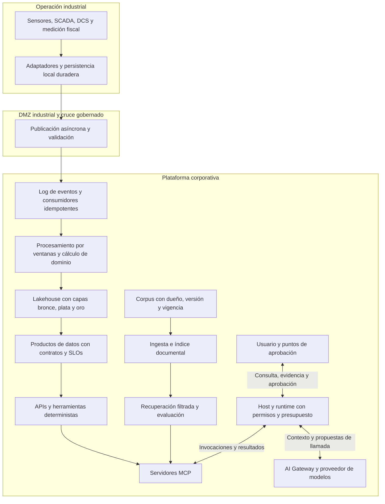

# Contexto de Arquitectura de Integración

**Universidad de los Andes · ARTI 4212 · Maestría en Arquitectura de TI**  
**Fecha de consolidación:** 31 de octubre de 2026.  
**Propósito:** conservar una base de conocimiento de la asignatura para estudiar, resolver talleres, diseñar soluciones y preparar sustentaciones con vocabulario y criterios consistentes con las clases.

Este documento consolida los **11 PDF y las 266 páginas** de la carpeta que en el proyecto se llama `Clases arquitectura de integración`. Se revisó el texto de todos los archivos y el contenido gráfico relevante, incluidos los diagramas que no aparecen en la extracción textual. Las referencias usan el número físico de página del PDF, empezando en 1.

La síntesis se basa en los materiales locales. La bibliografía citada por las clases se registra como ruta de profundización, sin presentarla como lectura adicional realizada. Los ejemplos, cifras y restricciones de PetroAndes pertenecen al caso académico. Las conclusiones y la arquitectura integradora se identifican como síntesis de los materiales, no como una solución ya implementada.

## Índice

1. [Resumen ejecutivo](#1-resumen-ejecutivo)
2. [Asignatura y fuentes revisadas](#2-asignatura-y-fuentes-revisadas)
3. [PetroAndes como contexto común](#3-petroandes-como-contexto-común)
4. [Fundamentos y diseño orientado a valor](#4-fundamentos-y-diseño-orientado-a-valor)
5. [Acoplamiento, semántica y patrones EIP](#5-acoplamiento-semántica-y-patrones-eip)
6. [Arquitectura hexagonal y contratos de APIs](#6-arquitectura-hexagonal-y-contratos-de-apis)
7. [Eventos, streaming y gobierno de esquemas](#7-eventos-streaming-y-gobierno-de-esquemas)
8. [Consistencia distribuida e integración IT/OT](#8-consistencia-distribuida-e-integración-itot)
9. [Integración y propiedad de los datos](#9-integración-y-propiedad-de-los-datos)
10. [Arquitecturas analíticas y productos de datos](#10-arquitecturas-analíticas-y-productos-de-datos)
11. [Integración documental, vectores y RAG](#11-integración-documental-vectores-y-rag)
12. [Tool calling y arquitecturas de agentes](#12-tool-calling-y-arquitecturas-de-agentes)
13. [MCP, A2A y AI Gateway](#13-mcp-a2a-y-ai-gateway)
14. [Arquitectura integradora del caso](#14-arquitectura-integradora-del-caso)
15. [Metodología y entregables de diseño](#15-metodología-y-entregables-de-diseño)
16. [Conclusiones y criterios para futuras consultas](#16-conclusiones-y-criterios-para-futuras-consultas)
17. [Glosario y bibliografía del curso](#17-glosario-y-bibliografía-del-curso)
18. [Diferencias de versión y límites del contexto](#18-diferencias-de-versión-y-límites-del-contexto)

## 1 Resumen ejecutivo

La asignatura estudia la integración como una **capacidad continua del negocio**, cuyo diseño abarca sistemas, datos, procesos, organizaciones y agentes. Su resultado esperado es una arquitectura justificable: qué se integra, para qué, con qué contratos, bajo cuáles restricciones y con qué evidencia de calidad y valor. El caso PetroAndes articula el recorrido mediante problemas de conciliación volumétrica, detección de pérdidas, operación industrial, comercialización, cumplimiento y sostenibilidad. ([S01], pp. 4–20; [S02], pp. 10–14).

El hilo conductor es la trazabilidad entre **motivador de negocio, escenario de calidad, capacidad de integración, decisión arquitectónica y KPI**. Una tecnología se selecciona después de conocer al dueño del dato, los consumidores, el volumen, la frecuencia, la latencia y las consecuencias de una falla. La distinción entre *blueprint* y *footprint* separa el diseño de capacidades y relaciones de la selección concreta de herramientas. Los escenarios de seis partes y el *utility tree* convierten expectativas generales en compromisos medibles y prioridades de diseño. ([S01], p. 14; [S02], pp. 10–22).

El primer bloque técnico combina patrones EIP, arquitectura hexagonal y contratos de APIs y eventos. El desacoplamiento debe permitir que los sistemas evolucionen y fallen con menor propagación de efectos, conservando una semántica compartida. REST, gRPC, GraphQL, SOAP encapsulado, colas y logs distribuidos tienen usos diferentes. En el caso industrial, la publicación asíncrona, la persistencia local, la DMZ y los consumidores idempotentes permiten integrar IT y OT con conectividad intermitente. Saga, Transactional Outbox, CQRS y Event Sourcing resuelven problemas distintos y pueden componerse. ([S03]–[S06]).

El bloque de datos distingue consolidación, federación y propagación, elegidas por flujo. La evolución hacia lakehouse y capas medallion aporta una base para analítica histórica y consumo controlado. Data mesh asigna responsabilidad a los dominios, mientras data fabric aporta capacidades de conexión mediante metadatos. El producto de datos expresa el compromiso del dominio mediante dueño, esquema, sensibilidad, SLOs y puertos de salida. ([S07], pp. 5–25; [S09], pp. 8–22).

El bloque de IA aplica esa misma disciplina a documentos y decisiones dinámicas. RAG integra conocimiento no estructurado mediante ingesta, recuperación, generación controlada y evaluación; requiere vigencia certificada, citas y capacidad de abstenerse. En los agentes, el modelo selecciona pasos e interpreta información, y el runtime ejecuta cálculos, validaciones y transacciones. MCP organiza el acceso a capacidades y contexto, A2A la delegación entre agentes y el AI Gateway concentra controles de consumo y política. La autonomía se concede en el nivel mínimo que resuelve el problema, con presupuesto, permisos, trazas y aprobación humana donde lo exige el diseño del curso. ([S10]–[S12]).

**Conclusión consolidada:** una buena integración conserva el significado del dato y hace explícitos sus responsables, contratos, límites y costos. Incorporar IA aumenta la importancia de esa disciplina: la exactitud permanece en componentes deterministas y las decisiones dinámicas se acotan con controles verificables.

## 2 Asignatura y fuentes revisadas

### 2.1 Identidad y enfoque pedagógico

Los materiales identifican el curso como **ARTI 4212, Arquitectura de Integración**, de la Maestría en Arquitectura de TI, Universidad de los Andes, Departamento de Ingeniería de Sistemas y Computación. Las guías corresponden a la versión 2026 y presentan sesiones de tres horas. La metodología combina preparación previa, actividades detonantes, teoría activa, trabajo por cadenas de valor, diagramación, prácticas en papel, laboratorio y defensa oral. ([S01], pp. 1–5 y 23; [S03], p. 1; [S07], pp. 24–27).

La competencia central consiste en diseñar y defender decisiones frente a restricciones y cambios de supuestos. Los materiales insisten en explicar alternativas descartadas y consecuencias operativas, además de manejar nombres canónicos de patrones. Las herramientas se tratan como implementaciones posibles de capacidades arquitectónicas.

### 2.2 Inventario completo

| Referencia | Documento revisado | Páginas | Aporte principal |
| --- | --- | ---: | --- |
| [S01] | ARTI4212_Sesión_01.pdf | 23 | Arquitectura, blueprint/footprint, cinco olas, caso y evaluación |
| [S02] | ARTI4212_Sesiones_2026_02.pdf | 25 | Encaje estratégico, mapa de valor, QAs, escenarios y priorización |
| [S03] | ARTI4212_Sesiones_2026_03.pdf | 27 | Acoplamiento, semántica, modelo canónico, EIP y hexagonal |
| [S04] | ARTI4212_Sesiones_2026_04.pdf | 27 | API-first, selección de protocolos, legado y API Management |
| [S05] | ARTI4212_S05_EDA.pdf | 22 | Colas y logs, ventanas, CloudEvents, AsyncAPI y schema registry |
| [S06] | ARTI4212_Sesion06.pdf | 24 | Saga, Outbox, CQRS, Event Sourcing, Purdue y convergencia IT/OT |
| [S07] | ARTI4212_Sesiones_2026_07.pdf | 29 | Propiedad del dato, consolidación, federación, propagación y parcial oral |
| [S09] | ARTI4212_Sesiones_2026_09.pdf | 24 | Analítica, warehouse, lake, lakehouse, medallion, mesh y data products |
| [S10] | ARTI4212_S10_Datos_para_GenAI.pdf | 20 | Embeddings, pipeline RAG, vigencia, evaluación y grafos |
| [S11] | ARTI4212_Sesiones_2026_11.pdf | 23 | Tool calling, determinismo selectivo, autonomía y contratos de herramientas |
| [S12] | ARTI4212_Sesion12.pdf | 22 | MCP, estado explícito, A2A, descubrimiento y AI Gateway |
| **Total** | **11 documentos** | **266** | **Cobertura documental de sesiones 1–7 y 9–12** |

Las referencias enlazan a los PDF originales mediante sus rutas absolutas, definidas al final del archivo.

### 2.3 Recorrido curricular y evaluación

El mapa más repetido presenta 16 semanas: fundamentos y caso en S1, QAs en S2, EIP y hexagonal en S3, APIs en S4, EDA en S5, cloud-native e IT/OT en S6, datos en S7, Parcial 1 oral en S8, lakehouse y mesh en S9, RAG en S10, agentes en S11 y protocolos agénticos en S12. Para S13–S16 anuncia orquestación con LangGraph, seguridad agéntica, AgentOps, BPMN, gobierno, iPaaS, FinOps y cierre evaluativo. **No hay guías de S8 ni de S13–S16 en la carpeta**; los últimos temas solo pueden registrarse en el nivel anunciado o mencionado por otras sesiones. ([S01], p. 2).

| Componente | Peso indicado en las guías |
| --- | ---: |
| Talleres | 20 % |
| Parcial 1 oral, ARB simulado | 25 % |
| Parcial 2 oral, comité de inversión | 25 % |
| Proyecto en grupo | 30 % |

El Taller 1 trabaja integración EDA/OT-IT. El Taller 2 desarrolla integración documental y diseño de conciliación con intervención humana. Las fechas por sesión varían entre documentos y se detallan en la sección 18; estos porcentajes y referencias no sustituyen el cronograma vigente del LMS. ([S01], p. 23; [S10], p. 19).

## 3 PetroAndes como contexto común

### 3.1 Cadenas de valor y ecosistema

| Cadena o dominio | Sistemas y datos mencionados | Problemas de integración trabajados |
| --- | --- | --- |
| Upstream | Pozos, PLC, SCADA, historiador AVEVA PI, Petrel/Eclipse, OSDU | Adquisición de datos, producción certificada, regalías e intercambio con ANH y socios |
| Midstream | Ductos, estaciones, presión, caudal, custody transfer, balance y nominaciones | Conciliación, detección de pérdidas, válvulas ilícitas y coordinación de transporte |
| Refinación o downstream industrial | DCS, MES, LIMS, optimizador de dieta de crudos y ERP | Sincronizar calidad, programación, transformación y balances de producción |
| Comercial | Medición fiscal, SAP IS-Oil, mayoristas, precios y FEPC | Diferencias medido/facturado, despachos, cupos, cartera y liquidación |
| HSE y transición energética | Sensores de emisiones, flaring, metano, EAM/IBM Maximo y granjas solares | Linaje de emisiones, reparación de fugas, reportes y decisiones de inversión |

Las láminas usan como escala del caso aproximadamente 5.400 pozos activos, 9.000 km de ductos, 35 remitentes y más de 2.000 estaciones aliadas. Sirven para razonar sobre volumen, interoperabilidad y costo, y deben identificarse como cifras del caso cuando se reutilicen. ([S04], pp. 22–25; [S06], p. 19).

### 3.2 Motivadores y resultados esperados

Los motivadores recurrentes son reducir pérdidas, conciliar información entre áreas, disminuir manualidad, cumplir reportes, acelerar comercialización y sustentar transición energética. Journey to Cloud y la plataforma de integración aparecen como habilitadores de esos resultados. Las referencias a ANH, FEPC, OGMP 2.0, Ley 2099 y ANLA se utilizan como contexto de exigencias del caso, sin que las guías constituyan un análisis jurídico de sus obligaciones. ([S02], pp. 4 y 10–14; [S04], pp. 22–25).

Las restricciones que más condicionan la arquitectura son la conectividad satelital intermitente, los sistemas legados, la necesidad de preservar la operación física, la separación IT/OT y la reconstrucción de evidencias regulatorias. Cada cadena añade consumidores y prioridades, pero comparte información con las demás.

## 4 Fundamentos y diseño orientado a valor

### 4.1 Conceptos de arquitectura

**Arquitectura:** estructura y comportamiento de un sistema, sus componentes y relaciones, y las decisiones, principios y criterios que gobiernan su evolución. Se concentra en elementos significativos y responde a stakeholders y condiciones del entorno. ([S01], pp. 6–11).

**Dominios de arquitectura:** especializaciones relacionadas, como negocio, aplicaciones, información y tecnología; seguridad y gobierno atraviesan esas perspectivas.

**Arquitectura empresarial:** marco de dirección y coherencia de la organización. **Arquitectura de solución:** diseño de alto nivel de una solución específica, complementario y conforme a la arquitectura empresarial. La implementación debe materializar las decisiones de la solución. ([S01], pp. 7–9).

**Arquitectura de integración:** en la lectura consolidada del curso, conjunto de decisiones sobre intercambios, contratos, semántica, coordinación, límites de confianza y operación de un ecosistema. Abarca interoperabilidad técnica y alineación organizacional.

**Blueprint:** capacidades, relaciones, estilos y diseño de alto nivel que explican qué integrar y por qué. **Footprint:** stack, productos, proveedores, configuración y mecanismos concretos que explican con qué y cómo se implementa. Un blueprint bien definido permite evaluar footprints alternativos. ([S01], pp. 12–17).

Las cinco olas presentadas son EAI/ESB, SOA, APIs y microservicios, EDA/streaming e integración agéntica. Se usan como marco evolutivo del curso: los patrones, los contratos y el gobierno atraviesan las distintas olas. ([S01], p. 16).

### 4.2 Motivadores, restricciones y requerimientos

Conviene distinguir cuatro entradas del diseño:

- **Motivador:** explica por qué cambiar, por ejemplo reducir pérdidas o responder a una exigencia de reporte.
- **Requerimiento funcional:** describe qué debe hacer la solución, por ejemplo conciliar un balance.
- **Restricción:** delimita el espacio de soluciones, por ejemplo impedir acceso entrante directo de la nube al control OT en el ejercicio.
- **Atributo de calidad o QA:** expresa cómo debe comportarse la solución, por ejemplo disponibilidad, desempeño, auditabilidad, seguridad o facilidad de evolución.

El diseño también depende de influencias técnicas, de negocio y sociales. Los **ADRs, Architecture Decision Records**, conservan la decisión y su justificación para orientar cambios futuros. ([S01], pp. 10–11; [S02], p. 14).

### 4.3 Cadena de trazabilidad del valor

La sesión 2 propone el siguiente encadenamiento:

```text
Motivador de negocio o regulatorio
  -> atributo de calidad y escenario
  -> capacidad de integración requerida
  -> componente arquitectónico
  -> palanca de valor
  -> KPI con línea base
  -> orden de magnitud del beneficio
```

El mapa de valor distingue **margen operativo, aumento de ingresos, eficiencia de activos y expectativas**. Una plataforma habilita valor cuando se conecta con un resultado verificable del proceso. Para evitar doble conteo, el ejercicio selecciona una palanca primaria por motivador y separa valor creado de valor protegido. La reducción de una pérdida esperada por incumplimiento no se contabiliza como ingreso. ([S02], pp. 8–11).

Ejemplos de KPIs de clase: barriles perdidos por mes, tiempo hasta detección, días-persona de reporte, observaciones del regulador, margen por barril, días de inventario o cartera, diferencia medido/facturado, emisiones por barril, costo por evento/GB y tiempo para habilitar una integración. Los beneficios requieren línea base y supuestos explícitos.

### 4.4 Escenarios de calidad de seis partes

| Parte | Pregunta que responde |
| --- | --- |
| Fuente | ¿Quién o qué origina el estímulo? |
| Estímulo | ¿Qué condición o evento ocurre? |
| Artefacto | ¿Qué elemento del sistema se afecta? |
| Ambiente | ¿En qué estado operativo ocurre? |
| Respuesta | ¿Qué debe hacer la solución? |
| Medida de respuesta | ¿Cómo se verifica cuantitativamente? |

**Ejemplo de disponibilidad de la guía:** una fuente de telemetría industrial produce datos mientras falla el enlace satelital, con bombeo en operación normal; el pipeline persiste localmente y reenvía al recuperar conectividad. La lámina fija como objetivo cero pérdida de eventos y latencia de recuperación menor de cinco minutos. **Ejemplo de auditabilidad:** ante la solicitud de un auditor en cierre trimestral, el módulo FEPC reconstruye el linaje y el cálculo de un reporte con precisión matemática y respuesta menor de dos minutos. Son metas de esos escenarios, sujetas a sus condiciones, no SLOs generales de toda PetroAndes. ([S02], pp. 15 y 18–19).

**Utility tree:** organiza y prioriza escenarios cruzando importancia de negocio y dificultad técnica, con escalas alta, media y baja. Los escenarios de alto valor y alta dificultad concentran atención arquitectónica. ([S02], pp. 20–21).

Las tácticas mostradas incluyen controlar demanda, muestreo, prioridades, tiempos y tamaños de cola; aumentar recursos o concurrencia; mantener copias; descubrir servicios, orquestar intercambios y adaptar interfaces. Cada táctica debe vincularse con el escenario que mejora y el costo que introduce. ([S02], pp. 16–17).

### 4.5 Caracterización del intercambio

**Volumen** indica cuánto se intercambia; **frecuencia**, cada cuánto y con qué picos; **latencia**, cuánto puede tardar el dato en ser utilizable. Unidades posibles: bytes por mensaje, registros por lote, GB/día, eventos por segundo y percentiles p95/p99 extremo a extremo.

La relación volumen por intercambio × frecuencia permite estimar throughput si las unidades son compatibles. Throughput alto combinado con baja latencia encarece el diseño. El curso contrasta alertas de anomalía en menos de un minuto, balance por hora y reportes que toleran días: cada necesidad justifica una solución diferente. ([S02], p. 22; [S07], p. 10).

## 5 Acoplamiento, semántica y patrones EIP

### 5.1 Acoplamiento como decisión multidimensional

**Acoplamiento** es dependencia entre sistemas que condiciona su capacidad de variar de forma independiente. Puede existir en tecnología, ubicación, formato, tipos, semántica, conversación, estilo de interacción y tiempo. El desacoplamiento reduce propagación de cambios y fallas, a cambio de infraestructura, complejidad y costo operativo. Su nivel adecuado depende también del control sobre los endpoints. ([S03], pp. 7–12).

El asincronismo reduce dependencia temporal, pero deja por resolver el significado de los mensajes, su evolución, los errores y la consistencia. Compartir JSON no garantiza que dos sistemas interpreten igual una medición.

### 5.2 Dimensiones, grados y niveles de integración

| Distinción | Significado en el curso |
| --- | --- |
| Estática | Intercambio de datos con conceptos compartidos |
| Funcional | Invocación de funciones o servicios sobre esa base semántica |
| Dinámica | Coordinación de un proceso mediante eventos y reglas |
| Organizacional | Correspondencia entre conceptos del software y el trabajo humano; dimensión transversal |
| Grado | Cantidad de semántica y reglas compartidas: un string aporta menos significado que una medición certificada |
| Nivel meta | Esquemas, catálogo y modelos que describen conceptos |
| Nivel concepto o tipo | Entidades y tipos de evento compartidos |
| Nivel instancia | Identificadores y espacios de nombres comunes |

La guía relaciona las dimensiones como dinámica ⊃ funcional ⊃ estática. También distingue dominios de datos, aplicaciones, procesos, presentación, B2B y agentes. ([S03], pp. 13–16).

### 5.3 Modelo conceptual y modelo canónico

**Modelo conceptual:** entidades y relaciones del negocio, independientes de los sistemas que las almacenan. **Modelo canónico:** acuerdo de intercambio sobre entidades, atributos, asociaciones y significado, al que se adaptan representaciones particulares. No equivale a la base de datos de una aplicación.

Los seis principios de la guía son entendibilidad, independencia respecto de aplicaciones, núcleo estable, extensibilidad, preservación de datos y operaciones en los mapeos, y separación por responsabilidad sobre la información. El patrón **núcleo + extensión** permite conservar una definición común de Medición y añadir información propia del regulador o de Transporte sin contaminar el núcleo. Se recomienda alcance acotado, estructuras cohesivas, asociaciones pensadas para el intercambio y validación con datos reales. ([S03], pp. 14–15).

### 5.4 Estilos y catálogo práctico de EIP

La sesión 3 remite a los cuatro estilos clásicos: transferencia de archivos, base de datos compartida, invocación remota y mensajería. Como síntesis para compararlos: los archivos facilitan lotes pero requieren control y seguimiento; una base compartida concentra dependencia sobre datos y esquema; la invocación remota introduce dependencia de disponibilidad y tiempo; la mensajería añade operación de canales y consistencia asíncrona a cambio de mayor independencia temporal. ([S03], pp. 4–6 y 26).

**Enterprise Integration Patterns, EIP**, proporciona un lenguaje de soluciones recurrentes. Patrones y elementos presentes en las guías:

| Patrón o elemento | Función | Uso en PetroAndes |
| --- | --- | --- |
| Message | Unidad de información intercambiada | Lectura o alerta |
| Message Channel | Conducto lógico del intercambio | Canal de telemetría |
| Message Endpoint | Conecta una aplicación con la mensajería | Entrada desde un adaptador de SCADA |
| Message Router / Content-Based Router | Selecciona ruta según reglas o contenido | Derivar un resultado normal o una anomalía |
| Message Translator | Transforma una representación en otra | Normalizar lecturas de distintos campos |
| Canonical Data Model | Estabiliza el significado del intercambio | Medición con unidad, activo y calidad acordados |
| Publish-Subscribe Channel | Distribuye un hecho a consumidores independientes | HSE, seguridad física y balance reciben la alerta |
| Aggregator | Reúne mensajes relacionados con una condición de completitud | Consolidar fuentes del reporte FEPC |
| Correlation Identifier | Permite asociar mensajes de una interacción o grupo | Vincular datos por tramo y ventana |
| Invalid Message Channel | Separa mensajes que incumplen el contrato esperado | Factura con formato o contenido inválido |
| Dead Letter Channel | Aísla mensajes que no pudieron entregarse o procesarse | Errores agotados para análisis y recuperación |
| Content Enricher | Añade información externa antes del procesamiento | Contexto documental recuperado en RAG |
| Channel Adapter | Adapta un sistema al canal de integración | Servidor MCP leído como adaptador |
| Routing Slip / Process Manager | Vocabulario para rutas y coordinación del proceso | Relación conceptual con la integración agéntica |

Fuentes: [S03], pp. 17–24 y 26; [S10], p. 17; [S11], p. 23; [S12], p. 8. Invalid Message Channel y Dead Letter Channel aparecen próximos en los ejercicios, pero conviene conservar la diferencia entre incumplimiento del mensaje y agotamiento o imposibilidad de procesamiento.

El flujo de balance trabajado combina adquisición, normalización, correlación por tramo y ventana, cálculo de dominio y enrutamiento del resultado. La lógica matemática debe quedar en el servicio de dominio; los canales y adaptadores absorben las particularidades del transporte. ([S03], pp. 21–24).

## 6 Arquitectura hexagonal y contratos de APIs

### 6.1 Puertos y adaptadores

La **arquitectura hexagonal** sitúa la lógica de negocio en el centro, expresa sus interacciones mediante **puertos** y conecta tecnologías concretas mediante **adaptadores**. El dominio de balance puede recibir mediciones de SCADA simulado o CSV histórico a través del mismo contrato, sin incorporar esas tecnologías a su lógica. Un adaptador posterior puede exponer capacidades para consumo por agentes. ([S03], pp. 20–22).

Los EIP gobiernan el intercambio entre sistemas y la hexagonal protege el interior de una aplicación. La conexión entre ambos es un contrato que traduce mensajes externos al lenguaje del dominio.

### 6.2 API-first y comparación de interfaces

**API-first:** diseñar, acordar y validar el contrato antes de implementar. La guía lo vincula con desarrollo paralelo de backend, frontend y pruebas, menor reproceso y una frontera explícita entre consumo e implementación. ([S04], pp. 8–11).

| Interfaz | Capacidad destacada | Costo o límite a evaluar | Uso sugerido en los ejercicios |
| --- | --- | --- | --- |
| REST y OpenAPI | Recursos y semántica HTTP, contrato legible para personas y herramientas | Tamaño y costo de serialización, número de llamadas y necesidades de streaming | Integración B2B, reportes, nominaciones y fachadas |
| gRPC y Protobuf | Contratos tipados, generación de clientes y streaming sobre HTTP/2 | Gestión de compatibilidad, conectividad y consumo web directo | Intercambios internos de alto rendimiento |
| GraphQL | El consumidor elige los campos y compone una vista sobre fuentes | Resolución, autorización, caché y costo de consultas | Portales y dashboards con necesidades variadas |
| SOAP y WSDL | Contratos explícitos y capacidades del legado transaccional | XML y complejidad del ecosistema existente | Preservar SAP IS-Oil y modernizar su consumo con fachada |

La tabla consolida las ventajas y trade-offs de [S04], pp. 12–15 y 21–25. Las ventajas de rendimiento o precisión deben verificarse en el escenario: no constituyen garantías automáticas por elegir un protocolo. El Modelo de Madurez de Richardson se incluye como lectura y tema de la sesión, sin desarrollo detallado de sus niveles en estas láminas.

La estrategia sobre legado es encapsular una capacidad estable cuando eso resuelve la necesidad de consumo. El criterio para modernizar es el beneficio y la restricción del caso, no la edad de la interfaz. Las APIs destinadas a agentes requieren descripciones y esquemas suficientemente explícitos para su selección dinámica, tema desarrollado en S11 y S12.

### 6.3 API Management

**API Gateway:** punto de ejecución de políticas y manejo de tráfico. **API Management:** capacidad más amplia que gobierna diseño, publicación, descubrimiento, acceso, monitoreo y ciclo de vida; incluye el gateway y un portal para desarrolladores. La interfaz de administración configura ese plano de control. ([S04], pp. 18–20).

Las políticas destacadas son autenticación y autorización, OAuth 2.0, mTLS, rate limiting, enrutamiento, transformación, caché y registro. En el caso industrial, estas políticas acompañan la separación de redes: un gateway no autoriza por sí mismo a atravesar la frontera OT.

El entregable de clase combina matriz de selección de tres interfaces, contrato conceptual con entradas/salidas y escenario de calidad, y ubicación del gateway con políticas justificadas. ([S04], p. 21).

## 7 Eventos, streaming y gobierno de esquemas

### 7.1 Evento, comando y consulta

- **Evento:** hecho ocurrido e inmutable, expresado en pasado, independiente de quién lo consume.
- **Comando:** solicitud de acción con destinatario y posibilidad de rechazo.
- **Consulta:** solicitud de información que no cambia el estado de negocio.

`AlertaGenerada` representa un evento y `EnviarAlerta` un comando. Los estilos de publicación incluyen notificación ligera, que obliga a consultar más datos; **event-carried state transfer**, que transporta estado suficiente para mayor autonomía del consumidor; y **Event Sourcing**, donde los eventos constituyen la historia autoritativa. ([S05], p. 4).

### 7.2 Cola y log distribuido

| Aspecto | Cola de trabajo tradicional | Log distribuido de eventos |
| --- | --- | --- |
| Intención | Distribuir trabajo entre ejecutores | Conservar hechos para múltiples usos |
| Consumo | Consumidores compiten por mensajes; en el modelo presentado, se eliminan tras procesarse y confirmarse | Consumidores mantienen posiciones independientes |
| Historia | Relectura no es su capacidad central | Retención y replay explícitos |
| Paralelismo | Reparto de tareas | Particiones y consumer groups |
| Ejemplo | Orden de despacho | Telemetría compartida por balance, alertas y analítica |

La sesión menciona RabbitMQ, SQS y JMS para colas, y Kafka, Redpanda, Pulsar y Kinesis para logs o capacidades de streaming. Se trata de familias arquitectónicas; cada producto ofrece comportamientos que deben revisarse en su configuración concreta. ([S05], pp. 5–7 y 13).

**Topic:** conjunto lógico de eventos. **Partición:** secuencia ordenada que permite distribuir el log. **Offset:** posición local a una partición. **Consumer group:** grupo que coordina el consumo y conserva su avance. **Retención:** política que determina cuánto historial permanece disponible.

Los grupos balance y alertas pueden avanzar a distinta velocidad sobre el mismo topic. El offset del log y el offset comprometido del grupo tienen funciones diferentes. Recuperar el avance depende de cuándo se confirma el procesamiento. El orden se garantiza dentro de la partición, por lo que su clave debe corresponder a la entidad cuyo orden importa. La clase destaca que particionar por estación puede perder el orden requerido por tramo. ([S05], pp. 5–8 y 13).

### 7.3 Garantías e idempotencia

| Garantía | Comportamiento del ejemplo de clase | Consecuencia |
| --- | --- | --- |
| At-most-once | Confirmar avance antes de procesar | Puede omitir un efecto tras una caída |
| At-least-once | Procesar antes de confirmar avance | Puede repetir el procesamiento |
| Exactly-once semántico | Coordinar procesamiento y avance dentro de una frontera transaccional | Garantiza el efecto dentro de esa frontera, no en cualquier sistema externo |

La recomendación recurrente es **at-least-once con consumidor idempotente**: identificar la operación o hecho y evitar que el reintento vuelva a acumular el mismo efecto. Se mencionan llaves naturales y upserts. Una escritura en SAP o una llamada externa requiere analizar nuevamente esa frontera. ([S05], p. 8).

**Idempotencia:** repetir la misma operación lógica conserva el efecto previsto de una sola ejecución. Deduplicación, identidad de evento, persistencia y confirmación deben diseñarse conjuntamente. Las garantías presuponen durabilidad y retención adecuadas; una etiqueta de entrega no cubre cualquier tipo de falla.

### 7.4 Procesamiento y event mesh

El procesamiento **sin estado** filtra, transforma o enruta cada mensaje de forma independiente. El procesamiento **con estado** agrega, cruza flujos o detecta condiciones sostenidas y necesita guardar y recuperar su estado.

Las ventanas **tumbling** son contiguas y sin solape; **sliding** se solapan; **session** agrupan actividad separada por períodos de inactividad. Los eventos tardíos exigen decidir si corregir o reabrir resultados. Kafka Streams, Flink y ksqlDB aparecen como ejemplos de procesamiento, diferenciado del transporte del broker. ([S05], p. 9).

**Event mesh:** red de brokers y puentes entre borde, DMZ y nube. En los ejercicios aporta buffering, filtrado o agregación local y réplica selectiva de topics. La persistencia cercana a la fuente permite continuar capturando información durante la desconexión. Su diseño debe respetar los conductos permitidos y el gobierno de esquemas y permisos. ([S05], pp. 11–12; [S06], pp. 7–8).

### 7.5 CloudEvents, AsyncAPI y schema registry

Las tres piezas resuelven responsabilidades diferentes:

| Pieza | Responsabilidad |
| --- | --- |
| CloudEvents | Sobre común para describir el evento y sus metadatos |
| AsyncAPI | Contrato de canales, mensajes, operaciones, servidores, protocolos y bindings |
| Schema registry | Registro, versionado y comprobación de compatibilidad de esquemas |

**CloudEvents:** la sesión identifica como obligatorios `id`, `source`, `specversion` y `type`; como útiles `time`, `subject`, `datacontenttype` y `dataschema`. El sobre permite enrutar, trazar y auditar sin interpretar toda la carga de dominio. En el ejercicio, `dataschema` enlaza con el esquema publicado. Su uso recomendado en el ejercicio no lo convierte en un atributo obligatorio general del estándar. ([S05], pp. 14–15).

**AsyncAPI 3.0:** separa canales de operaciones; `send` y `receive` se interpretan desde la aplicación documentada. El contrato debe incluir carga tipada, canales de error y perspectiva del servicio. La práctica define `ductos.telemetria.presion`, `ductos.telemetria.caudal` y `ductos.alertas.anomalia`, con estación, tramo, timestamp, valor, unidad y calidad del dato. ([S05], pp. 16–17).

**Schema registry:** gobierna esquemas como Avro, Protobuf o JSON Schema y detecta incompatibilidades al registrar versiones. La validación de compatibilidad no sustituye la validación de cada dato ni la de reglas del dominio. ([S05], pp. 18–19; [S06], p. 8).

| Regla | Relación de lectura que debe preservarse |
| --- | --- |
| BACKWARD | El consumidor con esquema nuevo puede leer datos antiguos |
| FORWARD | El consumidor con esquema antiguo puede leer datos nuevos |
| FULL | Se preservan ambas direcciones |
| NONE | No se impone esa protección de compatibilidad |

La guía asocia BACKWARD con actualizar consumidores primero y FORWARD con actualizar productores primero. Las listas de cambios permitidos son heurísticas: el resultado depende del formato, defaults, obligatoriedad y reglas del registry. Agregar un campo obligatorio sin mecanismo compatible, renombrar campos o restringir valores puede requerir una migración gradual. El ejercicio de S5 exige justificar esas decisiones sobre el esquema real. ([S05], pp. 18–19).

El laboratorio propuesto usa Redpanda, un productor de CloudEvents y dos consumer groups; observa fan-out, rechazo de una versión incompatible y replay. Estos son ejercicios documentados, no validaciones ejecutadas como parte de esta consolidación. ([S05], p. 21).

## 8 Consistencia distribuida e integración IT/OT

### 8.1 Patrones y problemas que resuelven

La sesión 6 contrasta el bloqueo y la dependencia temporal de 2PC con diseños de consistencia eventual apropiados para microservicios y enlaces intermitentes. Su énfasis es elegir la frontera de consistencia según el escenario. ([S06], pp. 4–13).

| Patrón | Problema central | Mecanismo | Costo o responsabilidad adicional |
| --- | --- | --- | --- |
| Saga | Coordinar un proceso que abarca transacciones locales | Secuencia de pasos con compensaciones ante fallas | Estado del proceso, fallas parciales y diseño de compensaciones |
| Transactional Outbox | Evitar inconsistencia entre guardar negocio y publicar evento | Guardar cambio y evento pendiente en una misma transacción local; publicar después | Relay o CDC, reintentos, retraso y consumidores idempotentes |
| CQRS | Diferenciar necesidades de modificación y consulta | Separar responsabilidades y modelos de comandos y consultas | Actualización de proyecciones y consistencia de lecturas |
| Event Sourcing | Conservar hechos históricos para derivar y reconstruir estado | Persistir eventos y reconstruir mediante replay | Evolución de eventos, proyecciones, retención y recuperación |

En una **Saga orquestada**, un coordinador decide los pasos. En una **Saga coreografiada**, los participantes reaccionan a eventos. Una compensación es una acción de negocio que contrarresta otra; no equivale a un rollback global de base de datos. ([S06], p. 10).

**Outbox** elimina el hueco de una escritura dual independiente, pero la publicación puede repetirse si hay incertidumbre sobre su confirmación. **CQRS** aparece en la guía con separación física y un modelo analítico en el lakehouse; su concepto esencial es separar responsabilidades y modelos, y el grado de separación física debe justificarse. **Event Sourcing** implica que la historia es autoritativa: tener un broker con retención no basta para adoptar ese patrón. ([S06], pp. 11–13; síntesis conceptual).

Los patrones son combinables: un servicio puede usar Outbox para publicar, alimentar proyecciones CQRS y participar en una Saga. Event Sourcing responde a una necesidad histórica diferente y requiere decisión propia.

### 8.2 IT, OT y fronteras de confianza

**OT, Operational Technology**, supervisa o controla procesos físicos. **IT, Information Technology**, soporta capacidades corporativas, comerciales, analíticas y digitales. La integración debe evitar que una consulta corporativa o falla de red comprometa el control de planta. ([S06], pp. 15–18).

El curso usa la siguiente representación de Purdue/ISA-95, ampliada en sus diagramas con DMZ y nube:

| Zona de las guías | Responsabilidad representada |
| --- | --- |
| Niveles 0–2 | Proceso físico, instrumentación, control y supervisión OT |
| Nivel 3 | Operación de planta, consolidación local e historiadores |
| Nivel 3.5 | DMZ industrial y cruce gobernado |
| Niveles 4–5 | Sistemas corporativos y nube; el caso ubica el lakehouse en N5 |

La sesión presenta **IEC 62443** mediante zonas, conductos y defensa en profundidad. Una **zona** agrupa activos con necesidades de seguridad relacionadas; un **conducto** delimita el intercambio autorizado entre zonas. La **DMZ industrial** intermedia el cruce para evitar una red plana entre operación y entorno corporativo. ([S06], pp. 15–17).

Los niveles de nube y DMZ son convenciones empleadas en el curso. Purdue, ISA-95 e IEC 62443 cumplen funciones relacionadas pero diferentes; no deben tratarse como nombres intercambiables de una sola norma.

### 8.3 Restricción de diseño del caso

Para la práctica de Rubiales, la guía prohíbe llamadas entrantes síncronas directas desde IT/nube N5 al control OT N2/N3. Los datos se publican desde OT, cruzan de forma asíncrona la DMZ y se consumen desde el lado corporativo. Esta es una restricción explícita del ejercicio, y no una afirmación de que cualquier implementación industrial deba tener exactamente la misma topología. ([S06], pp. 16–18).

La solución debe considerar persistencia local, capacidad del buffer ante caídas prolongadas, reenvío, identidad, orden y tratamiento de eventos tardíos. Si regresan tres horas de telemetría, el análisis debe conservar la diferencia entre tiempo de medición y tiempo de llegada para no interpretar todo el backlog como un suceso actual. La guía plantea ese caso como pregunta de diseño. ([S06], pp. 18–22).

**Síntesis operativa:** demostrar cero pérdida exige dimensionar almacenamiento y recuperación para un horizonte de falla explícito. Outbox, un log local o un broker no hacen ilimitada la memoria del borde. La trazabilidad histórica requiere también controles de acceso, conservación y recuperación; el nombre Event Sourcing no garantiza por sí solo inviolabilidad del registro.

## 9 Integración y propiedad de los datos

### 9.1 Preguntas previas a la tecnología

Integrar datos implica extraer, reestructurar, mover, consultar y cargar información entre contextos operacionales, analíticos y organizacionales, preservando su significado. La sesión 7 exige partir del modelo conceptual, los dueños, el modelo canónico y las características de volumen, frecuencia y latencia. ([S07], pp. 5–12).

**Dueño del dato:** autoridad que crea o mantiene la información válida y resuelve discrepancias para una entidad o alcance definido. Se identifica preguntando quién crea, quién actualiza, dónde se valida y a qué sistema cree la organización cuando aparecen diferencias. Deben diferenciarse el sistema autoritativo de origen y el dominio responsable de un producto derivado. La autoridad sobre una medición no se transfiere automáticamente a SAP o al lakehouse por copiarla allí. ([S07], pp. 6–9; [S09], pp. 18–22; síntesis).

El criterio de un dueño evita escrituras competitivas y determina la dirección del intercambio. La matriz de propiedad identifica qué sistema crea, modifica o elimina cada entidad y cuál decide en un conflicto. La práctica trabaja medición de custody transfer, factura de transporte, contrato ANH, orden de mantenimiento, calidad de producto y nominación. ([S07], p. 24).

### 9.2 Tres formas de integración de datos

| Forma | Intención | Cuándo se justifica | Responsabilidad y riesgo |
| --- | --- | --- | --- |
| Consolidación | Crear un repositorio persistente a partir de fuentes diversas | Historia, cruces masivos, reinterpretación y preservación de estados | Reconciliar copias, asegurar calidad y gobernar el repositorio |
| Federación | Ofrecer una vista de fuentes distribuidas sin consolidar una copia persistente | Consultas puntuales, restricciones de copia o necesidad de consultar la fuente actual | Dependencia de las fuentes, carga en cada consulta y semántica de la vista |
| Propagación | Mantener información disponible en otros destinos a partir de cambios del origen | Reacción operativa, sincronización y baja latencia | Duplicados, divergencia, contratos y operación continua |

La clasificación responde a la **intención por flujo**. La latencia típica de los ejemplos no es su definición: una consolidación puede alimentarse continuamente mediante propagación. Una arquitectura puede combinar las tres. La federación evita una nueva copia consolidada, pero no elimina redundancia o desorden que ya exista en las fuentes. ([S07], pp. 14–22).

### 9.3 Mecanismos y tecnologías como implementaciones

**ETL:** extraer, transformar y cargar. **ELT:** extraer, cargar y transformar en el destino. La guía explica el auge de ELT por almacenamiento económico y cómputo elástico, que permiten conservar datos crudos y transformarlos cuando se necesitan. La decisión también desplaza costos al consumo y exige gobierno y FinOps. Ambos mecanismos siguen siendo opciones según restricciones. ([S07], p. 13).

**CDC, Change Data Capture:** capturar cambios del origen para transmitirlos a otros sistemas; el curso destaca CDC de log y Debezium sobre Kafka Connect. **Reverse ETL:** llevar información curada o derivada del analítico a la operación, por ejemplo un score de riesgo usado para programar patrullajes. **Virtualización o consulta federada:** resolver una vista sobre datos que permanecen bajo sus fuentes. ([S07], pp. 19–25).

Los ejemplos de herramientas incluyen suites y servicios de carga, Airbyte/Fivetran y dbt para partes del flujo de consolidación; Denodo y motores federados para consulta; GoldenGate, Striim, Debezium, Kafka y Redpanda para propagación. Su presencia en las láminas no implica que el curso imponga un proveedor ni que una herramienta cubra por sí sola toda la forma de integración. ([S07], p. 23).

Para cada flecha del diseño se debe poder declarar **forma, latencia, dueño y contrato**. El mapa de referencia conecta SAP por CDC, PI por streaming, LIMS por batch, contratos por federación y resultados analíticos por reverse ETL. La guía aclara que es una lectura posible y que la necesidad de historia puede cambiar la decisión sobre los contratos. ([S07], pp. 24–25).

## 10 Arquitecturas analíticas y productos de datos

### 10.1 Separación de propósitos

El sistema transaccional registra y valida operaciones con acceso a pocos registros; el analítico cruza grandes volúmenes y responde preguntas cambiantes. Consultas analíticas intensivas sobre la operación pueden degradar el servicio. La clase diferencia analítica **descriptiva** —qué ocurrió—, **diagnóstica** —por qué—, **predictiva** —qué podría ocurrir— y **prescriptiva** —qué acción conviene—. Historia, calidad y linaje condicionan esas capacidades. ([S09], pp. 5–7).

### 10.2 Warehouse, lake y lakehouse

| Arquitectura | Aporte principal en el recorrido del curso | Riesgo o compromiso |
| --- | --- | --- |
| Data warehouse o bodega | Información estructurada e integrada para consumo analítico | Rigidez, costo o dificultad para ampliar variedad y escala |
| Data lake o lago | Conservación de datos de diversa naturaleza próximos al formato original | Convertirse en un repositorio sin calidad, interpretación o responsables |
| Lakehouse | Combinar almacenamiento de objetos y formatos de tabla con gestión transaccional y consumo BI/ML | Gobierno, interoperabilidad de formatos y operación del ciclo de datos |

La evolución de las guías es conceptual, no una obligación de reemplazar toda bodega. Las capacidades reales dependen de la implementación. Los formatos abiertos citados, **Apache Iceberg y Delta Lake**, aportan mecanismos de transacciones, evolución y consulta de versiones sobre datos del lago. ([S09], pp. 8–16).

El **modelo dimensional** organiza un hecho de negocio, dimensiones que lo contextualizan y métricas que lo cuantifican. La guía compara **Kimball**, con data marts conformados por dimensiones compartidas; **Inmon/CIF**, con bodega corporativa normalizada y marts derivados; y una aproximación híbrida. El modelo dimensional conserva utilidad como forma de consumo dentro de arquitecturas modernas. ([S09], p. 8).

La clase presenta tres formas de convivencia entre bodega y lago: mantener ambos conectados por catálogo y gobierno, llevar historia de la bodega al lago, o usar la bodega como zona de resultados del procesamiento del lago. La selección depende de la historia existente y de la responsabilidad operativa. ([S09], p. 15).

### 10.3 Medallion, historia y consumo

**Bronce:** conserva datos de origen e historia de ingesta. **Plata:** limpia, filtra y estandariza. **Oro:** publica agregaciones o resultados listos para el negocio. Cada capa debe tener significado y reglas propios; el color no reemplaza un contrato de calidad. ([S09], pp. 13 y 20).

El versionado permite responder qué información sustentó un reporte en una fecha anterior. Para que esa reconstrucción sea operable hay que conservar versiones durante el horizonte requerido, junto con reglas de transformación y linaje. El curso lo conecta con auditoría regulatoria. ([S09], p. 14; síntesis de operación).

### 10.4 Data mesh y data fabric

Los cuatro principios de **data mesh** presentados son:

1. Propiedad del dato por dominio.
2. Dato tratado como producto consumible.
3. Plataforma de autoservicio que reduzca dependencia del equipo central.
4. Gobierno federado con estándares comunes de interoperabilidad y seguridad.

**Data fabric** se presenta como la capacidad tecnológica de conectar y automatizar acceso mediante metadatos activos. Mesh responde principalmente por la responsabilidad y organización; fabric, por capacidades de conexión y gestión. Son compatibles y no sustituyen al mecanismo de integración de cada flujo. ([S09], pp. 16–18 y 21).

### 10.5 Producto y contrato de datos

Un **data product** es un activo de información preparado para consumidores, con responsabilidad y compromisos explícitos. Puede exponer batch, streaming o API según el uso. El contrato incluye:

| Elemento | Definición necesaria |
| --- | --- |
| Identificador y dominio | Qué producto es y quién responde por él |
| Sensibilidad | Clasificación y restricciones de acceso o uso |
| Esquema central | Campos, unidades, reglas y semántica que el consumidor debe entender |
| SLOs | Objetivos medibles de frescura, completitud y disponibilidad |
| Puertos de salida | Interfaces para cada tipo de consumo |
| Evolución | Versionado, compatibilidad, aviso y migración |

El ejemplo de **balance volumétrico conciliado** asigna responsabilidad a Transporte y declara frescura menor de 15 minutos, completitud de 99,9 % y disponibilidad de 99,9 %, con salidas por tabla, topic y API. Son cifras ilustrativas de la ficha mostrada, no objetivos asumidos para cualquier producto del proyecto. ([S09], pp. 19 y 22).

La arquitectura de referencia de S9 incorpora fuentes OT e IT, integración, lakehouse, almacén vectorial, series de tiempo, procesamiento, MLOps, IA, BI y activación. Gobierno, catálogo, linaje, identidad y costo atraviesan esas capacidades. ([S09], p. 21).

## 11 Integración documental, vectores y RAG

### 11.1 Conocimiento no estructurado como dato gobernado

Manuales, procedimientos, contratos y comunicaciones también tienen dueño, versión, vigencia, sensibilidad y calidad. La sesión 10 plantea que integrarlos exige la misma disciplina aplicada a tablas o eventos. Una respuesta sobre un límite operativo debe basarse en la fuente autorizada y mostrar su procedencia. ([S10], pp. 4–6).

**Embedding:** representación numérica que permite comparar cercanía semántica. **Búsqueda vectorial:** recuperación por similitud entre representaciones. **Índice aproximado:** acelera la recuperación a escala a cambio de un compromiso de exactitud de búsqueda. La similitud no certifica validez, actualidad ni autorización del documento. El modelo de embeddings es una dependencia versionada; cambiar de espacio de representación exige una estrategia de migración y reindexación. ([S10], p. 7).

El **almacén vectorial** es un sistema derivado que necesita ingesta, actualización, responsable y contrato. El curso relaciona su carga inicial con consolidación y su mantenimiento con propagación. La decisión entre motor especializado y extensión de una base existente depende de escala, centralidad de la recuperación y complejidad operativa o de gobierno. ([S10], pp. 8–9).

### 11.2 Cuatro etapas del pipeline RAG

**RAG, Retrieval-Augmented Generation**, incorpora información recuperada al contexto de generación. La guía desarrolla cuatro etapas, cada una con decisiones, fallas y medición propias. ([S10], pp. 10–14).

| Etapa | Decisiones y controles del curso |
| --- | --- |
| 1 Ingesta | Extraer contenido, respetar títulos, tablas y párrafos, elegir tamaño y solape por tipo documental, adjuntar metadatos y certificar vigencia |
| 2 Recuperación | Aplicar filtros de metadatos antes o durante la búsqueda, combinar búsqueda semántica y léxica, decidir cantidad de fragmentos y reordenamiento |
| 3 Generación controlada | Responder con base en el material recuperado, citar documento/versión/sección y abstenerse si falta evidencia |
| 4 Evaluación | Medir respaldo de respuestas, relevancia de recuperación y desviación con casos de referencia |

El tamaño de fragmento no tiene un valor universal: una tabla de límites y un procedimiento requieren estrategias distintas. Todo atributo que el consumidor necesite filtrar debe estar disponible como metadato desde la ingesta. Una ficha útil identifica documento, versión, sección, tipo, activo o dominio, vigencia y autoridad que la certifica; sensibilidad y permisos completan el diseño de acceso. ([S10], pp. 11–12 y 18; [S09], p. 21).

**Búsqueda híbrida:** combina similitud y coincidencia exacta para códigos, referencias e identificadores. **Reranking:** reordena candidatos para mejorar precisión a costa de latencia. La elección de cuántos fragmentos incluir afecta calidad, costo y contexto. ([S10], p. 12).

**Grounding o anclaje:** grado en que la respuesta se respalda en las fuentes recuperadas. Las citas son parte del contrato, junto con la abstención. Exigirlas por prompt debe acompañarse de evaluación: una instrucción no garantiza por sí misma que cada afirmación sea correcta. ([S10], pp. 13–14; síntesis).

La evaluación necesita preguntas y respuestas esperadas. Debe separar un error de recuperación de un error de generación, medir degradación y comprobar que el sistema no usa procedimientos derogados para responder consultas de operación vigente. La fecha de un archivo, por sí sola, no reemplaza la regla de vigencia certificada.

### 11.3 Vector, grafo o herramienta exacta

| Necesidad | Mecanismo apropiado según el criterio de la sesión |
| --- | --- |
| Localizar una definición o procedimiento | Recuperación documental, vectorial o híbrida, con filtros |
| Recorrer relaciones entre activos, contratos y dependencias | Grafo de conocimiento, eventualmente combinado con documentos |
| Obtener un valor actual o calcular un balance exacto | Consulta o herramienta determinista sobre el sistema autorizado |

**Grafo de conocimiento:** entidades conectadas por relaciones tipadas. Permite formular preguntas de varios saltos, con el costo de construir y mantener esas relaciones. El curso propone añadirlo en el subdominio donde esas preguntas justifiquen el costo, en vez de asumir que todo RAG necesita un grafo. ([S10], pp. 15–18).

La lectura EIP de la sesión reconoce Content Enricher al añadir contexto a la consulta, modelo canónico para estructurarlo y traducción o filtrado para controlar lo que recibe el destino. Es una analogía arquitectónica que conecta RAG con el vocabulario previo. ([S10], p. 17).

## 12 Tool calling y arquitecturas de agentes

### 12.1 Determinismo selectivo y frontera de ejecución

**Tool calling:** el modelo produce una intención de llamada estructurada; el runtime la valida y ejecuta. El ciclo recibe objetivo y catálogo, selecciona herramienta y argumentos, ejecuta código y devuelve el resultado al contexto para continuar o cerrar. ([S11], pp. 5–8).

**Determinismo selectivo:** asignar al código lo que exige exactitud y reproducibilidad, y al modelo tareas de interpretación, selección dinámica y redacción. En el caso, la diferencia volumétrica, validación de tramo/período, reglas y transacciones se resuelven en componentes deterministas. El agente investiga y explica usando los resultados. ([S11], p. 9).

La **frontera de ejecución** es el punto donde una propuesta del modelo se convierte en acceso o efecto empresarial. Allí deben operar validación de dominio, autorización, auditoría, idempotencia y límites. Un argumento puede cumplir JSON Schema y referirse a un tramo inexistente: validar forma y validar verdad son responsabilidades distintas. ([S11], pp. 7 y 16).

### 12.2 Escalera de autonomía

| Peldaño | Forma de decisión | Ejemplo de clase |
| --- | --- | --- |
| Workflow determinista | Ruta y reglas conocidas, sin modelo | Liquidación mensual de regalías |
| Workflow aumentado | Flujo fijo con un paso que requiere juicio sobre texto | Clasificación de reclamos |
| Cadena o enrutamiento | Composición o selección entre rutas conocidas | Triaje hacia un procedimiento |
| Agente | Selecciona próximos pasos según hallazgos intermedios | Investigación de una diferencia volumétrica |

El criterio es usar el nivel de menor autonomía que resuelva el problema. Al subir crecen capacidad de adaptación, costo, latencia y dificultad de evaluación. Las rutas variables requieren auditar episodios concretos. Un flujo conocido puede contener IA sin necesitar un agente. ([S11], pp. 10–12 y 22).

**Presupuesto de episodio:** límites de pasos o llamadas, costo y tiempo total. Al agotarlos, el sistema se detiene, entrega lo establecido con fuentes y declara lo incompleto. No completa hallazgos por inferencia para aparentar cierre. ([S11], p. 13).

### 12.3 Contrato y permisos de herramientas

Una herramienta necesita nombre, descripción que explique cuándo usarla, parámetros tipados, retorno, errores y granularidad comprensible. Su diseño debe añadir clasificación lectura/efectos, permisos, aprobación cuando corresponda, comportamiento ante reintentos y clave de idempotencia. ([S11], pp. 14–18).

En el modelo de gobierno enseñado, las consultas de solo lectura mantienen autorización y registro, y las operaciones con efectos requieren aprobación humana explícita. Esa política es un requisito del diseño académico descrito, y debe representarse como control del runtime y de los servicios. Las credenciales efectivas y el alcance de la identidad se aplican al acceso concreto; el nombre de un agente no concede permisos. ([S11], p. 15; [S12], pp. 6 y 20).

La **clave de idempotencia** la genera y conserva el runtime para la operación lógica, de manera estable entre reintentos. Así, un timeout después de crear un ticket no produce otro ticket al repetir la llamada. Su generación no se delega al modelo. ([S11], p. 17).

El prompt de sistema declara rol, alcance, herramientas, prohibiciones, condiciones de parada y formato de salida. Es una parte del gobierno, complementada por límites efectivos en código. La sesión diferencia explícitamente una intención escrita en el prompt de un control impuesto por el runtime. ([S11], p. 18).

### 12.4 Fallas y evidencia del episodio

Los modos de falla destacados son selección de herramienta incorrecta, parámetros inventados, efectos duplicados y mala interpretación de un resultado correcto. También debe acotarse el bucle de ejecución por presupuesto. ([S11], pp. 13 y 16–17).

La práctica propone de cuatro a seis herramientas para investigar una diferencia de 3 %: consultar balance, recuperar series ya publicadas, listar mantenimientos, buscar procedimientos y preparar un borrador. El 3 % es el disparador del ejercicio, no una tolerancia general aplicable a todos los tramos. El agente consume información expuesta del lado IT y no accede directamente a OT. ([S11], pp. 19–21).

Una traza útil registra la pregunta de cada paso, una justificación breve de la herramienta elegida, los argumentos, resultados, validaciones, errores, costo y punto de aprobación. Es evidencia del flujo observable, sin exigir conservar razonamiento interno privado del modelo. La aprobación debe presentar al humano los hallazgos, fuentes y acción concreta que se propone. **Preparar, aprobar y ejecutar un envío son estados distintos**: disponer de una herramienta de envío no materializa por sí mismo la aprobación. ([S11], pp. 20–21; síntesis para documentar el episodio).

## 13 MCP, A2A y AI Gateway

### 13.1 Protocolos y reducción de conexiones particulares

La sesión 12 usa el problema de M agentes y N sistemas para explicar el valor de una frontera común: pasar de integraciones particulares por pareja, M × N, a adaptaciones por participante, del orden de M + N. Es una simplificación del esfuerzo de conexión, no la desaparición del trabajo de semántica, autorización, operación y pruebas. ([S12], pp. 2 y 5).

### 13.2 Roles y primitivas MCP

**MCP, Model Context Protocol**, se estudia como protocolo para exponer capacidades y contexto a aplicaciones con modelos. La guía define:

| Rol | Responsabilidad |
| --- | --- |
| Host | Aplicación y runtime que gestionan contexto, bucle, servidores habilitados, permisos y presupuesto |
| Cliente | Conexión creada por el host para comunicarse con un servidor |
| Servidor | Exposición de capacidades de un sistema mediante un catálogo y contratos |

El host puede tener varios clientes, cada uno vinculado a un servidor, de forma que los accesos y las fallas puedan administrarse por conexión. La arquitectura del servidor se interpreta como Channel Adapter y como adaptador hexagonal. ([S12], pp. 6 y 8).

| Primitiva | Naturaleza | Control de incorporación según la guía | Ejemplo |
| --- | --- | --- | --- |
| Tools | Operaciones con parámetros y efectos declarados | El modelo propone su invocación; el runtime gobierna la ejecución | Consultar balance |
| Resources | Contexto de lectura identificado por URI | La aplicación selecciona su incorporación | Lista de tramos y límites autorizados |
| Prompts | Plantillas reutilizables de interacción | La persona las selecciona explícitamente | Plantilla para investigar una diferencia |

Convertir todos los elementos en tools altera quién decide incorporar contexto. Tampoco se deben exponer credenciales como contenido para el modelo. La práctica exige distinguir primitivas, datos que necesitan preparación y elementos que no deben entrar al protocolo. ([S12], pp. 7 y 16–18).

Los transportes explicados son **stdio**, para un proceso local, y **Streamable HTTP**, para servidores remotos. La sesión asocia el primero con la frontera de la máquina y el segundo con autorización de red e intermediarios. Que un transporte sea local no elimina los controles del proceso ni de los sistemas a los que accede. ([S12], p. 8; síntesis).

### 13.3 Detalles de versión presentados en S12

**Alcance de esta subsección:** registra lo enseñado en la guía, que se atribuye a una revisión MCP `2026-07-28`. No se ha contrastado aquí esa revisión con una especificación externa. Estos campos y cambios deben tratarse como referencias versionadas del material académico y verificarse contra la versión del SDK/protocolo antes de implementar.

La guía presenta las siguientes decisiones y las relaciona con preocupaciones clásicas de integración:

| Contenido atribuido por la guía a esa revisión | Lectura arquitectónica |
| --- | --- |
| Eliminación de handshake `initialize` y sesiones; versión/capacidades en `_meta` | Peticiones autocontenidas y escalabilidad horizontal |
| `server/discover` | Descubrimiento y negociación explícita de compatibilidad |
| `ttlMs` y `cacheScope` en listados | Frescura, alcance y costo de la caché |
| Contexto de traza OpenTelemetry en `_meta` | Seguimiento extremo a extremo |
| Ventana de deprecación de doce meses | Gobierno del ciclo de vida |
| MRTR, `InputRequiredResult` y `resultType` | Expresar información faltante y reintentar con entrada adicional |

La misma guía enumera deprecaciones de roots, sampling, logging, HTTP+SSE y registro dinámico OAuth, con rutas de migración sugeridas. Son afirmaciones de ese documento, no instrucciones universales aplicables a cualquier versión de MCP. ([S12], pp. 8–12 y 21–22).

El principio que sí puede conservarse al margen de una versión concreta es distinguir **estado de protocolo** de **estado de negocio**: una investigación reanudable necesita identificar qué información debe sobrevivir, dónde se persiste, quién emite sus identificadores y cómo se evita duplicar operaciones. Un protocolo sin sesiones no elimina esa necesidad. ([S12], pp. 9 y 16).

### 13.4 A2A y fronteras

**A2A, Agent-to-Agent**, se presenta como delegación entre agentes, destacando el cruce de organizaciones. La **Agent Card** publica identidad, capacidades y condiciones de acceso de la contraparte; la guía estudia su verificación y firma. Cada organización conserva control sobre sus sistemas internos. ([S12], pp. 13–15).

| Criterio de la clase | MCP | A2A |
| --- | --- | --- |
| Relación | Agente o host con capacidades de un sistema | Agente con otro agente |
| Unidad | Invocación concreta | Tarea delegada, eventualmente prolongada |
| Contrato visible | Catálogo de capacidades y esquemas | Agent Card y condiciones de la tarea |
| Responsabilidad ilustrada | Runtime y servicios propios | Contraparte que acepta la tarea |
| Pregunta de diseño | ¿Qué capacidad se necesita ejecutar o consultar? | ¿Qué tarea debe asumir otro participante? |

La sesión distingue frontera de ejecución, frontera de confianza/credenciales y frontera organizacional. La comparación orienta la topología del caso; no implica que toda comunicación A2A deba ocurrir entre empresas diferentes. La cronología de fundaciones y versiones que aparece en la guía es contexto histórico del material y no se usa aquí como certificación de actualidad de los protocolos.

### 13.5 Escala del catálogo y AI Gateway

Cuando el catálogo crece, cargar todas sus definiciones y todos los resultados intermedios puede consumir contexto y presupuesto. La clase propone **divulgación progresiva**, incorporando solo lo necesario, y ejecutar filtros o joins en código cerca de los datos. Esto requiere controlar también el entorno de ejecución y sus recursos. ([S12], p. 19).

**AI Gateway:** capacidad de gobierno para invocaciones a modelos y herramientas. La guía incluye enrutamiento de modelos/proveedores, cuotas y costos por token, caché semántica, guardrails, auditoría, enmascaramiento de PII y DLP. Lo ubica entre hosts y proveedores y, según el diseño presentado, también ante servidores MCP corporativos. ([S12], p. 20).

La caché debe respetar permisos, vigencia y alcance de los datos, y el gateway complementa los controles de host y servicio. El nombre de una categoría de producto no garantiza todas esas capacidades en una implementación concreta.

## 14 Arquitectura integradora del caso

El siguiente esquema es una **síntesis de referencia elaborada a partir de las clases**, especialmente [S03], pp. 20–24; [S05], pp. 11–20; [S06], pp. 15–18; [S09], p. 21; [S10], pp. 10–17; [S11], pp. 7–9; y [S12], pp. 6–20. Expresa capacidades y fronteras, sin seleccionar un footprint ni afirmar que exista un despliegue con esta topología.



Las flechas iniciales representan publicación de datos desde OT hacia IT. Las invocaciones del agente se limitan a capacidades expuestas en el entorno corporativo. Las demás fuentes IT pueden integrarse por CDC, carga o federación según el flujo, aunque se omiten del diagrama para hacerlo legible. Gobierno, catálogo, linaje, observabilidad, identidad y FinOps atraviesan las capas.

Una lectura extremo a extremo permite conectar los conceptos:

1. Una medición se captura con identificador, activo, tiempo, valor, unidad y calidad, y se conserva localmente para el horizonte de desconexión diseñado.
2. Adaptadores normalizan su representación; el cruce DMZ valida y publica por conductos permitidos.
3. El log distribuye el hecho a balance, alertas y analítica con partición, retención y avance independientes.
4. El servicio determinista calcula el balance con reglas declaradas y tratamiento de eventos tardíos; sus resultados alimentan proyecciones y productos de datos.
5. El dominio publica un producto con dueño, SLOs e interfaces para consumo analítico y operativo.
6. Ante una anomalía, un workflow o agente consulta datos autorizados y procedimientos vigentes. El runtime conserva las verificaciones y cálculos exactos.
7. El sistema prepara un hallazgo con fuentes y solicita aprobación para los efectos que la política académica exige controlar. El registro de la aprobación y la ejecución posterior permanecen diferenciados.

Esta composición no obliga a usar todos los patrones en todo flujo. La selección depende del problema: Outbox para publicación consistente, Saga para un proceso distribuido, CQRS para modelos de consulta y escritura, Event Sourcing cuando la historia de hechos debe ser autoritativa, y RAG cuando hace falta recuperar conocimiento documental.

## 15 Metodología y entregables de diseño

### 15.1 Secuencia de trabajo consolidada

La siguiente metodología sintetiza el recorrido de las sesiones. No corresponde a una nueva metodología oficial añadida al programa.

1. **Delimitar el problema de negocio.** Identificar proceso, actores, dolor, resultado esperado, línea base y palanca de valor.
2. **Reconocer fuentes y autoridad.** Modelar entidades, identificar quién crea o modifica cada dato y resolver quién decide ante discrepancias.
3. **Caracterizar los flujos.** Documentar origen, destino, volumen, frecuencia, picos, latencia, sensibilidad y necesidad de historia.
4. **Formular escenarios medibles.** Especificar las seis partes y priorizar importancia/dificultad en el utility tree.
5. **Declarar restricciones.** Incluir legado, conectividad, frontera IT/OT, operación humana, presupuesto y plazos del caso.
6. **Seleccionar estilo y patrones.** Justificar síncrono/asíncrono, cola/log, consolidación/federación/propagación y patrones de consistencia.
7. **Diseñar contratos.** Definir semántica, identidad, esquemas, errores, compatibilidad, SLOs, permisos y política de evolución.
8. **Dibujar el blueprint.** Mostrar sistemas, dominios, puertos, zonas y dirección de flujos. Asociar cada flecha con dueño, forma, latencia y contrato.
9. **Acotar el componente de IA.** Elegir workflow o agente, fijar frontera determinista, corpus autorizado, presupuesto y puntos de aprobación.
10. **Comparar footprints.** Evaluar alternativas por capacidad, costo, operabilidad y restricciones, y registrar ADRs.
11. **Definir evidencia.** Elegir cómo comprobar recuperación, replay, idempotencia, compatibilidad, calidad del dato, fidelidad documental y comportamiento ante fallas.
12. **Defender y revisar.** Explicar la decisión y sus costos, responder a un cambio de supuesto y vincular el resultado con el KPI inicial.

La calidad del argumento se comprueba en la cadena completa: una tecnología apropiada no compensa un dueño indefinido o un escenario sin medida. ([S02], pp. 10–22; [S04], p. 21; [S07], pp. 24–28; [S09], p. 22; [S10], p. 18; [S11], p. 21).

### 15.2 Fichas reutilizables

Estas fichas son una organización propuesta para futuras consultas, derivada de los entregables de las guías.

**Ficha de escenario de calidad**

| Campo | Contenido que debe quedar definido |
| --- | --- |
| Problema y motivador | Resultado que necesita el negocio y actor que lo exige |
| QA | Propiedad que se pretende lograr |
| Seis partes | Fuente, estímulo, artefacto, ambiente, respuesta y medida |
| Prioridad | Importancia de negocio y dificultad técnica |
| Supuestos | Volúmenes, fallas y condiciones dentro de las cuales se promete la medida |
| Evidencia | Observación, prueba o medición que demuestra el compromiso |

**Ficha de decisión o ADR**

| Campo | Contenido que debe quedar definido |
| --- | --- |
| Identificador y estado | Decisión, versión y situación de aprobación |
| Contexto | Problema, motivadores, escenarios y restricciones |
| Alternativas | Opciones viables consideradas |
| Decisión | Opción elegida y alcance |
| Justificación | Relación con QAs, valor y restricciones |
| Consecuencias | Costos, riesgos, dependencias y limitaciones aceptadas |
| Verificación y revisión | Evidencia prevista y cambio de supuesto que obliga a reconsiderar |

**Ficha de intercambio o producto de datos**

```text
Identificador, propósito y dominio responsable
Origen autoritativo y consumidores
Forma de integración y puerto de salida
Esquema, semántica, unidades e identidad
Volumen, frecuencia, picos y latencia
Frescura, completitud y disponibilidad
Sensibilidad, autorización y trazabilidad
Garantía de entrega, duplicados, orden y errores
Historia, retención y recuperación
Compatibilidad, versionado y migración
```

**Ficha adicional de herramienta agéntica**

```text
Nombre y descripción para decidir cuándo usarla
Parámetros, validaciones de dominio, retorno y errores
Lectura o efectos; permisos y aprobación
Idempotencia y responsabilidad del runtime
Tiempo, costo y política de reintentos
Fuentes, vigencia y trazabilidad de la respuesta
```

### 15.3 Talleres y proyecto

**Taller 1:** las guías lo construyen progresivamente con diagrama EIP, puertos y adaptadores, contrato AsyncAPI/CloudEvents, compatibilidad de esquemas e integración OT/IT con anomalías. La sesión 6 añade persistencia local y cruce seguro para el caso de campo remoto. ([S03], pp. 23–25; [S05], pp. 17–21; [S06], pp. 18–23).

**Taller 2, según S10:** distingue un **Escenario A que se implementa**, consulta documental gobernada con contrato de corpus, vigencia, recuperación filtrada/híbrida, herramientas MCP y evaluación; y un **Escenario B de diseño**, conciliación con aprobación humana, BPMN 2.0, frontera determinista, matriz herramienta × permiso y trazabilidad. ([S10], p. 19).

S11 habilita catálogo de herramientas, permisos y frontera determinista del escenario B. S12 habilita el servidor MCP del escenario A y plantea decisiones de primitivas, estado y catálogo. La descripción de los 19 documentos del corpus proviene de S10; el contenido de la carpeta de corpus del proyecto no forma parte del análisis de clases realizado aquí. ([S11], p. 22; [S12], p. 21).

**Proyecto:** los materiales señalan una primera entrega en S10 y otra al cierre del curso. El mapa inicial de sistemas y dolores alimenta la primera entrega. No se dispone en esta carpeta del enunciado completo ni de la rúbrica integral del proyecto. ([S01], pp. 5 y 23).

### 15.4 Defensa oral y cambios de supuestos

El Parcial 1 se presenta como un **ARB, Architecture Review Board, simulado**. La sesión 7 describe cinco minutos de preparación con una tarjeta individual, cinco de pitch dibujando y cinco de preguntas, incluidas dos preguntas ancla y una que modifica un supuesto. ([S07], p. 26).

| Criterio publicado para el Parcial 1 | Peso |
| --- | ---: |
| Corrección técnica y vocabulario canónico | 30 % |
| Trade-offs y alternativas descartadas | 25 % |
| Comunicación y estructura | 20 % |
| Manejo de preguntas y cambio de supuestos | 20 % |
| Anclaje en el caso | 5 % |

La estructura de defensa propuesta es respuesta directa, argumentos clave y datos de soporte. El diagrama acompaña la explicación. Volumen, contrato, retención y costo sostienen el argumento; si falta un dato, se explicita y se explica cómo se razonaría o verificaría. ([S07], pp. 26–28).

Ejemplos de cambios de supuesto que permiten estudiar la coherencia de un diseño: más duración de una desconexión, menor latencia exigida, un consumidor nuevo, cambio incompatible del evento, necesidad de reconstruir historia o paso de consulta a operación con efectos. La respuesta debe revisar los compromisos afectados y no limitarse a añadir otra herramienta.

## 16 Conclusiones y criterios para futuras consultas

### 16.1 Conclusiones transversales

1. **La integración depende del significado compartido.** El formato, el canal y el protocolo permiten transportar información, mientras entidades, unidades, reglas e identificadores permiten interpretarla.
2. **La autoridad y el contrato ordenan la topología.** Saber quién responde por el dato permite decidir dirección, copia, reconciliación y compromisos de servicio.
3. **Los atributos de calidad convierten necesidades en decisiones verificables.** Cada promesa debe declarar condiciones y medida; las cifras de los ejemplos no se transfieren automáticamente a otra solución.
4. **El desacoplamiento tiene costos y dimensiones.** Asincronismo, adaptadores y modelos compartidos resuelven dependencias específicas, con mayor operación y complejidad donde corresponde.
5. **La resiliencia se demuestra extremo a extremo.** Captura, persistencia, publicación, consumo y efectos externos necesitan supuestos de falla, retención, identidad y recuperación coherentes.
6. **Las arquitecturas de datos combinan mecanismos.** Propagación puede alimentar consolidación; federación puede servir datos que no conviene copiar; reverse ETL lleva resultados a la acción.
7. **Los datos analíticos y documentales necesitan responsables.** Lakehouse, índice vectorial y grafo pierden utilidad sin calidad, vigencia, linaje y actualización.
8. **La IA conserva una frontera determinista.** El modelo aporta interpretación y selección dinámica; las reglas exactas, permisos y transacciones permanecen en componentes controlados.
9. **La autonomía exige evidencia y límites.** Presupuesto, evaluación, trazas y aprobación permiten operar rutas que se construyen en ejecución.
10. **La justificación une arquitectura y valor.** La decisión se sostiene con escenarios, alternativas y KPIs, y conserva razones para reconsiderarla cuando cambia el contexto.

Estas conclusiones son la lectura consolidada del conjunto [S01]–[S12], con la cobertura disponible indicada en el inventario.

### 16.2 Criterios de consulta y uso del contexto

Para una consulta futura sobre un problema de la asignatura, conviene iniciar con proceso, motivador, actor, dueño del dato y restricción; después precisar escenario de calidad y flujo. La respuesta puede organizarse como decisión, razones, diagrama, contrato, costos y evidencia. Las fuentes locales permiten volver a la página de clase cuando el vocabulario o el requisito de evaluación sea relevante.

Al usar este archivo se deben mantener separadas cuatro categorías: **contenido explícito de clase**, **síntesis de varias sesiones**, **supuesto del ejercicio** y **propuesta de solución**. Una recomendación para el proyecto no demuestra que el caso ya opere de esa manera. Los detalles de protocolos, normas y cronogramas deben conservar su versión y alcance.

Preguntas que resumen el criterio del curso:

- ¿Qué resultado de negocio cambia y cómo se mide?
- ¿Dónde vive la información autoritativa y quién responde por el contrato?
- ¿Qué volumen, frecuencia, latencia e historia necesita cada consumidor?
- ¿Qué ocurre ante caída, duplicación, retraso, incompatibilidad o falta de evidencia?
- ¿Qué parte debe ser exacta y qué parte admite interpretación?
- ¿Qué alternativa se descartó y qué costo se aceptó?

## 17 Glosario y bibliografía del curso

### 17.1 Glosario de consulta rápida

| Término | Significado en este contexto |
| --- | --- |
| ADR | Registro de una decisión arquitectónica, su contexto y consecuencias |
| API | Interfaz mediante la que se expone una capacidad de software |
| API-first | Contrato diseñado y acordado antes de implementar |
| ARB | Comité de revisión arquitectónica; formato del primer parcial oral |
| Blueprint / footprint | Diseño de capacidades y relaciones / concreción tecnológica |
| B2B | Intercambio entre organizaciones |
| CDC | Captura y propagación de cambios del origen |
| Contrato | Acuerdo explícito de semántica, estructura, comportamiento y evolución |
| CQRS | Separación de responsabilidades y modelos de comandos y consultas |
| Custody transfer | Medición asociada a transferencia de custodia del producto en el caso |
| Data product | Información consumible con dominio responsable, contrato y SLOs |
| Data mesh | Organización por dominios y productos, autoservicio y gobierno federado |
| Data fabric | Capacidades de conexión y gestión mediante metadatos activos |
| DMZ | Zona intermedia que gobierna el cruce entre redes con distinta confianza |
| EAM | Gestión de activos empresariales; las clases mencionan IBM Maximo |
| EDA | Arquitectura orientada a eventos |
| EIP | Patrones de integración empresarial de Hohpe y Woolf |
| ELT / ETL | Cargar y luego transformar / transformar antes de cargar |
| Embedding | Representación vectorial usada para comparar cercanía semántica |
| Event Sourcing | Eventos históricos como fuente autoritativa para derivar el estado |
| Grounding | Respaldo de la respuesta generada en evidencia recuperada |
| HSE | Salud, seguridad y medioambiente, con variación de denominación entre láminas |
| Idempotencia | Repetición de una operación lógica sin duplicar su efecto previsto |
| Lakehouse | Gestión analítica que combina capacidades de lago y bodega |
| LIMS | Sistema de información de laboratorio |
| MAOP | Máxima presión operativa admisible, en los ejemplos del caso |
| MCP | Protocolo estudiado para exponer capacidades y contexto a hosts con modelos |
| MES | Sistema de ejecución de manufactura u operación de planta |
| Offset | Posición de un evento o de avance de lectura dentro de una partición |
| Outbox | Registro transaccional de eventos pendientes para publicación posterior |
| QA | Atributo de calidad de una solución |
| RAG | Generación apoyada en información recuperada de fuentes |
| Replay | Reprocesamiento de eventos conservados |
| Runtime | Entorno que valida y ejecuta las llamadas propuestas por el modelo |
| Saga | Coordinación de transacciones locales con compensaciones |
| SCADA | Supervisión, control y adquisición de datos industriales |
| SLO | Objetivo medible de nivel de servicio |
| Tool calling | Propuesta estructurada de invocación que ejecuta el runtime |

### 17.2 Lecturas citadas en las guías

Las siguientes referencias forman parte de la bibliografía de clase; su inclusión no indica que se hayan revisado sus textos completos durante esta consolidación.

| Tema | Referencias señaladas por los materiales | Sesiones |
| --- | --- | --- |
| Patrones y arquitectura | Hohpe y Woolf, *Enterprise Integration Patterns*; Cockburn, *Hexagonal Architecture* | S1, S3, S10–S12 |
| Atributos y perspectivas | Bass, Clements y Kazman, *Software Architecture in Practice*, 4.ª ed.; Rozanski y Woods; QAW del SEI | S2 |
| APIs | Richardson Maturity Model, materiales de API Management, gRPC y GraphQL | S4 |
| Eventos | Bellemare, *Building Event-Driven Microservices*; AsyncAPI 3.0; CloudEvents; documentación de brokers y registry | S5 |
| Distribución e industria | Patrones Saga y Transactional Outbox de microservices.io; Purdue; documentación de CQRS | S6 |
| Datos | White, *Data Integration: Using ETL, EAI and EII Tools*; DAMA-DMBOK; Kleppmann, *Designing Data-Intensive Applications* | S7 |
| Arquitectura analítica | Dehghani, *Data Mesh*; Kimball y Ross; Inmon; Iceberg y Delta Lake | S9 |
| RAG y agentes | Huyen, *AI Engineering*; Lewis et al., RAG; Edge et al., GraphRAG; Yao et al., ReAct; *Building Effective Agents* | S10–S11 |
| Protocolos agénticos | Especificaciones MCP y A2A; materiales de ejecución en código con MCP y AI Gateway | S12 |

Las guías bibliográficas se encuentran en [S01], p. 22; [S02], p. 25; [S03], p. 26; [S04], p. 27; [S05], p. 22; [S06], p. 24; [S07], p. 29; [S09], p. 24; [S10], p. 20; [S11], p. 23; y [S12], p. 22.

## 18 Diferencias de versión y límites del contexto

1. **Cobertura de la carpeta.** Contiene guías de S1–S7 y S9–S12. La ausencia de guías de otras sesiones no demuestra que esos temas no se hayan impartido. LangGraph, AgentOps, seguridad agéntica, BPMN, iPaaS y FinOps se conservan solo con la profundidad efectivamente anunciada o mencionada; no se inventan capítulos de sesiones ausentes.
2. **Duración y cierre del curso.** El mapa repetido indica 16 semanas, pero la portada y evaluación de S3 incluyen referencias a 17 semanas y al cierre en S17. Se conserva el mapa predominante como orientación curricular, sin resolver una fecha administrativa por inferencia. ([S01], p. 2; [S03], pp. 1–2 y 27).
3. **Publicación y entrega del Taller 2.** S9 anuncia publicación allí y entrega en S15; S10 vuelve a anunciar su publicación y describe entrega/sustentación en sesión aparte al cierre del contenido. S11 menciona habilitación posterior hasta S16. Para una entrega concreta se necesita el enunciado y cronograma vigentes. ([S09], pp. 1 y 23; [S10], pp. 1 y 19; [S11], p. 22).
4. **Frontera IT/OT.** Algunos retos de protocolos en S4 plantean comunicación síncrona con sistemas de planta. S6 explicita una restricción de no acceso directo entrante desde nube hacia OT para la práctica industrial. Al combinar sesiones debe hacerse visible esa condición y ubicar las consultas sobre datos ya publicados o en zonas autorizadas. ([S04], pp. 23–25; [S06], pp. 16–18).
5. **Protocolos versionados.** La revisión MCP y cronología A2A de S12 se registran como contenido de esa guía. No se verificaron contra documentación externa. `initialize`, `_meta`, `server/discover`, `ttlMs`, `cacheScope`, MRTR, firmas y deprecaciones requieren confirmar versión y soporte antes de programar. La sección 13.3 conserva esa distinción.
6. **Simplificaciones didácticas.** Expresiones como la desaparición de SOAP o 2PC, las equivalencias entre familias de productos y las tablas de cambios compatibles se leen en el contexto del argumento docente. No se convierten en reglas absolutas de diseño. El propio curso propone encapsular SOAP cuando conserva valor y justificar cada elección.
7. **Cifras ilustrativas.** SLOs, presupuesto de episodio y umbrales de ejemplos pertenecen a sus escenarios. Los porcentajes de problemas de bodegas o beneficios de APIs que aparecen en algunas láminas no se reutilizan como evidencia empírica independiente sin su fuente y condiciones. ([S04], p. 19; [S09], pp. 9 y 19; [S11], pp. 13 y 19).
8. **Documentos fuera del alcance.** Esta consolidación no incorpora como fuentes el caso completo, la actividad ni el corpus ubicados fuera de la carpeta de clases. Tampoco sustituye el syllabus, los enunciados completos o los requisitos de evaluación vigentes.

### Referencias a los archivos originales

[S01]: <C:/Users/jcjca/OneDrive/Documentos/ChatGPT/Taller 2 Arquitecura de Integración/Clases arquitectura de integración/ARTI4212_Sesión_01.pdf>
[S02]: <C:/Users/jcjca/OneDrive/Documentos/ChatGPT/Taller 2 Arquitecura de Integración/Clases arquitectura de integración/ARTI4212_Sesiones_2026_02.pdf>
[S03]: <C:/Users/jcjca/OneDrive/Documentos/ChatGPT/Taller 2 Arquitecura de Integración/Clases arquitectura de integración/ARTI4212_Sesiones_2026_03.pdf>
[S04]: <C:/Users/jcjca/OneDrive/Documentos/ChatGPT/Taller 2 Arquitecura de Integración/Clases arquitectura de integración/ARTI4212_Sesiones_2026_04.pdf>
[S05]: <C:/Users/jcjca/OneDrive/Documentos/ChatGPT/Taller 2 Arquitecura de Integración/Clases arquitectura de integración/ARTI4212_S05_EDA.pdf>
[S06]: <C:/Users/jcjca/OneDrive/Documentos/ChatGPT/Taller 2 Arquitecura de Integración/Clases arquitectura de integración/ARTI4212_Sesion06.pdf>
[S07]: <C:/Users/jcjca/OneDrive/Documentos/ChatGPT/Taller 2 Arquitecura de Integración/Clases arquitectura de integración/ARTI4212_Sesiones_2026_07.pdf>
[S09]: <C:/Users/jcjca/OneDrive/Documentos/ChatGPT/Taller 2 Arquitecura de Integración/Clases arquitectura de integración/ARTI4212_Sesiones_2026_09.pdf>
[S10]: <C:/Users/jcjca/OneDrive/Documentos/ChatGPT/Taller 2 Arquitecura de Integración/Clases arquitectura de integración/ARTI4212_S10_Datos_para_GenAI.pdf>
[S11]: <C:/Users/jcjca/OneDrive/Documentos/ChatGPT/Taller 2 Arquitecura de Integración/Clases arquitectura de integración/ARTI4212_Sesiones_2026_11.pdf>
[S12]: <C:/Users/jcjca/OneDrive/Documentos/ChatGPT/Taller 2 Arquitecura de Integración/Clases arquitectura de integración/ARTI4212_Sesion12.pdf>
