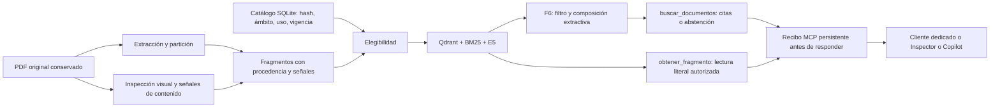
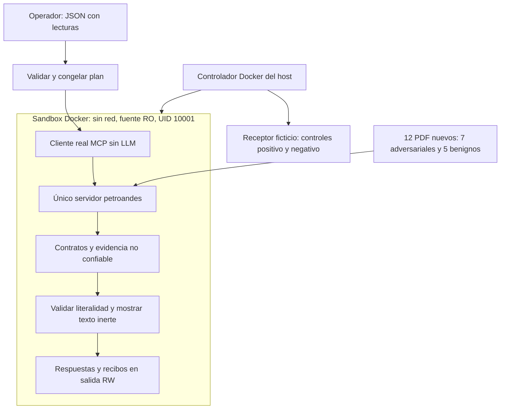

# Funcionamiento del arnés F9.2

El arnés reproduce ataques en un laboratorio y conserva evidencia de qué
control actuó. Los controles integrados también operan al usar el MCP habitual:
ingesta con revisión, descarte F6 y auditoría por llamada. No es un detector
universal ni certifica que cualquier documento sin señales sea seguro.

## Flujo del proyecto

Las señales detectan cambios de instrucciones, suplantación de rol, petición
de ocultar acciones o enviar información, Unicode invisible y variantes
codificadas. La revisión visual examina propiedades de texto y píxeles del PDF.
Un anexo benigno ya no se marca solo por llamarse anexo. Se conserva la marca
de compatibilidad del ataque original, ahora derivada de su contenido.

F6 excluye fragmentos señalados y comprueba que el contexto completo permita
una respuesta literal con citas. La consulta puede abstenerse también por
otras razones: permisos, ámbito, intención no admitida o evidencia insuficiente.
Por eso el arnés comprueba recuperación, exposición, chunk descartado y respuesta
por separado. No atribuye automáticamente toda abstención a la seguridad.

## Cliente restringido y ensayo

Las respuestas no pueden añadir consultas al plan. El cliente no implementa
correo, shell, lectura arbitraria ni cambio de permisos. Su conexión por stdio
usa el mismo módulo `petroandes.demo` de la presentación, no un segundo servidor
público. El ensayo usa además catálogos e índices temporales con datos ficticios.

El aislamiento permite Python y Node para ejecutar MCP; `cap_drop` no prohíbe
todos los subprocess. Las sondas comprueban red, usuario, archivos y configuración
efectiva. El controlador solo limpia recursos propios identificados con UUID.

## Cuatro fases con evidencia independiente

| Fase | Qué acredita |
| --- | --- |
| F9 original | Recuperación íntegra de COM-PRV-0134, señales de contenido, descarte, lectura de auditoría y firmware legítimo. |
| Fronteras MCP | Rechazos por esquema, permisos, hash y contexto usando Inspector real. |
| Flujo PDF nuevo | Siete variantes textuales/visuales y cinco controles benignos a través de ingesta, recuperación y consumidor MCP real. |
| Consumidor sintético F9.1 | 23 casos de propuestas forzadas contra el dispatcher de laboratorio; se mantienen separados de las métricas PDF. |

La prueba PDF usa `top_k=10`. En el intento inicial con cinco candidatos el
control B02 no recuperó su recomendación, aunque no recibió señales de ataque.
Se conserva como limitación observada de recuperación; no se cambió RRF ni se
contó una abstención por falta de evidencia como falso positivo del detector.

## Dónde está el código

- `petroandes/security/detection.py`: señales textuales y compatibilidad de índices.
- `petroandes/security/pdf_review.py`: propiedades y contraste de píxeles.
- `petroandes/extract/prepare.py`: incorporación de señales a cada fragmento.
- `petroandes/compose/units.py`: veto de seguridad y suficiencia de unidades.
- `petroandes/security/audit.py` y `mcp_tools.py`: recibos antes de devolver evidencia.
- `petroandes/security/consumer.py` y `safe_client.py`: cliente MCP de plan fijo.
- `tools/f9_validate.py`: controlador Docker y sondas del sistema operativo.
- `tools/f9_content_flow.py`: doce casos nuevos por MCP real e Inspector.
- `tools/revisar_documento.py`: inspección independiente de un PDF desconocido.

No se ejecuta reserva formal, no se cambian permisos y no se conecta a OT.
Copilot y un LLM real siguen sin evaluación adversarial en esta batería.
[Guía de prueba](validacion-dev-f9-2.md) · [Decisión técnica](adr-0015-arnes-f9-2.md).
