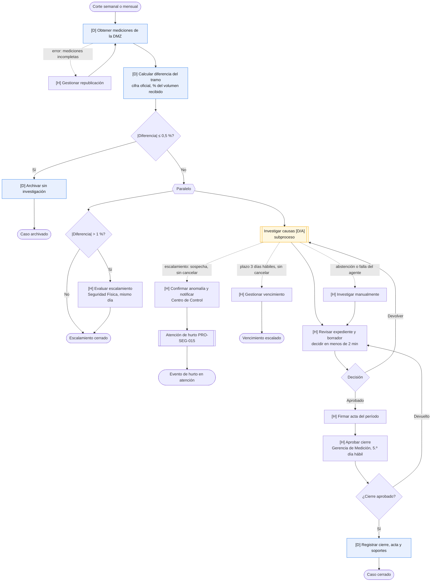
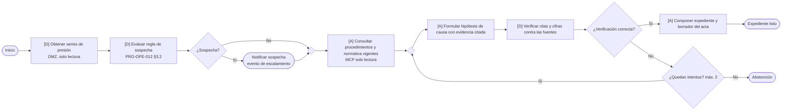
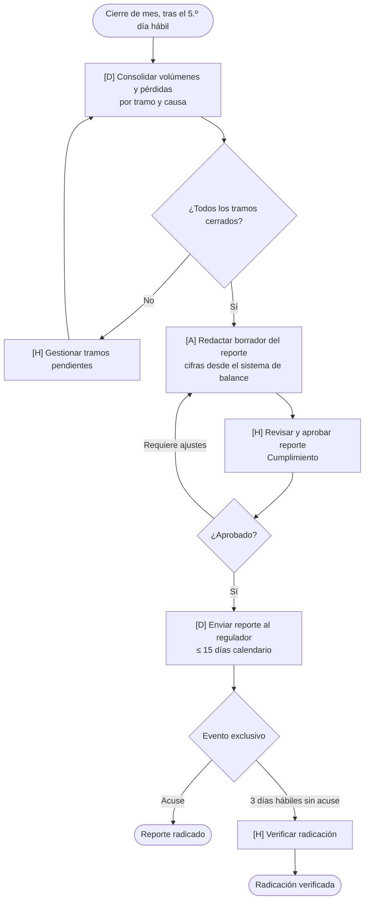
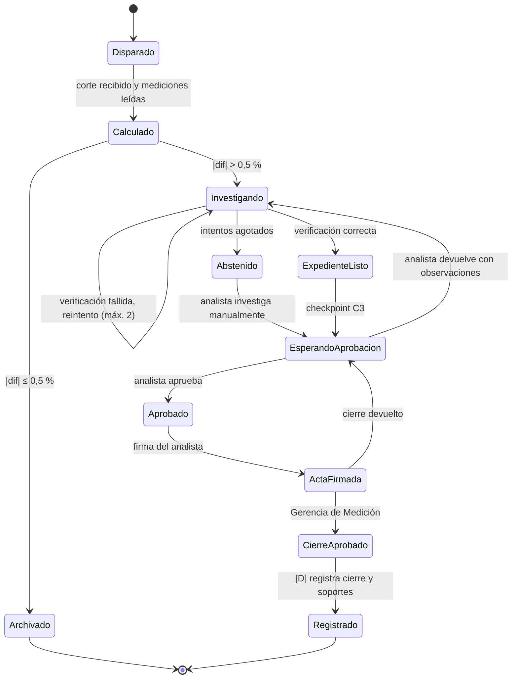

# Escenario B — Conciliación volumétrica con aprobación humana

**Taller 2 · ARTI 4212 — Documento de arquitectura**

Caso: PetroAndes S.A. / AndesTransporte S.A.S. (corpus sintético del taller).
Alcance: diseño del flujo agéntico que detecta una diferencia de balance volumétrico, investiga causas plausibles y prepara un borrador, con **revisión humana obligatoria antes de cualquier envío**.

Modelo normativo: `conciliacion_volumetrica_escenario_B_v3.bpmn`. Convención de los nombres de tarea: `[D]` determinista, `[A]` agéntico, `[H]` humano.

---

## 1. Por qué es un proceso de negocio y no un workflow técnico

1. **Cruza áreas con responsabilidad declarada:** Analista de Medición, Gerencia de Medición, Centro de Control, Seguridad Física, Cumplimiento y dos externos (autoridad competente y regulador sectorial).
2. **Tiene resultado de negocio con valor regulatorio:** un cierre conciliado y un reporte mensual sustentable ante el regulador (`RES-ANH-0471-2023`).
3. **La decisión relevante es humana:** firma del acta, aprobación del cierre y aprobación del reporte. El sistema prepara, no decide.
4. **Tiene caminos de excepción de negocio:** sospecha de sustracción (deriva a otro proceso), mediciones incompletas, vencimiento de plazo y devoluciones.

El grafo de orquestación (§4) es un workflow técnico subordinado: vive dentro del subproceso de investigación y está gobernado por el proceso de negocio.

---

## 2. Modelo del proceso en BPMN 2.0

### 2.1 Estructura

El modelo tiene **dos procesos** y **tres participantes de caja negra**:

| Pool | Contenido | Frecuencia |
| --- | --- | --- |
| **Caso por tramo y corte** | Obtener datos, calcular, archivar o investigar, aprobar, firmar acta y cerrar | Un caso por tramo y por corte (semanal o mensual) |
| **Consolidación y envío del reporte mensual** | Consolidar, redactar borrador, aprobar y enviar | Una vez al mes, todos los tramos |
| DMZ industrial (nivel 3.5) | Publica mediciones y series de presión | Caja negra |
| Autoridad competente | Recibe el reporte de evento de hurto (≤24 h) | Caja negra |
| Regulador sectorial | Recibe el reporte mensual y devuelve acuse | Caja negra |

La separación obedece a `RES-ANH-0471-2023` art. 2: el reporte es **mensual y consolidado**, no por caso.

**Lanes del proceso por caso:** Sistema de balance volumétrico, Agente de conciliación (identidad no humana), Analista de medición del tramo, Gerencia de Medición, Centro de Control de Operaciones, Gerencia de Seguridad Física.
**Lanes del proceso mensual:** Sistema de balance, Agente de conciliación, Gerencia de Cumplimiento.

**Figura 1. Modelo BPMN completo con supuestos** (exportado de bpmn.io desde el `.bpmn`):

Los diagramas Mermaid siguientes son vistas simplificadas de esta figura.

### 2.2 Flujo del proceso por caso (vista de lectura rápida)

### 2.3 Subproceso «Investigar causas de la diferencia [D/A]»

La regla de sospecha es una **regla determinista** (`businessRuleTask`). El agente no decide si hay sospecha. La verificación de citas y cifras también es determinista y actúa como control sobre lo que produjo el agente.

### 2.4 Proceso mensual de reporte

### 2.5 Elementos BPMN presentes en el modelo

| Elemento | Uso |
| --- | --- |
| Evento de inicio con temporizador | Corte semanal (`R/P1W`) y cierre mensual (`R/P1M`) |
| Compuertas exclusivas, paralela y basada en eventos | Tolerancia, escalamiento, decisión del analista, cierre, acuse |
| `serviceTask`, `businessRuleTask`, `userTask`, `sendTask` | Nodos `[D]` y `[H]` tipados por su naturaleza |
| `subProcess` con su propio diagrama | Investigación |
| `callActivity` | Atención de hurto (`PRO-SEG-015`), proceso independiente |
| Eventos límite | Error por mediciones incompletas, escalamiento por sospecha, plazo de 3 días, abstención del agente |
| Evento de escalamiento | Notificación de sospecha |
| `dataStore` | Registro de conciliación por tramo (soportes 5 años) |
| Flujos de mensaje | DMZ → sistema, evento → autoridad, reporte → regulador, acuse |
| Anotaciones S-01 a S-30 | Supuestos y decisiones, separados de lo que sale del corpus |

---

## 3. Frontera determinista / agéntica / humana

| Nodo | Clase | Justificación |
| --- | --- | --- |
| Obtener mediciones de la DMZ | **[D]** | Lectura de datos publicados. Sin acceso directo a OT (restricción del Taller 1). |
| Calcular diferencia del tramo | **[D]** | `PRO-MED-007 v2` §2.2: cálculo determinista; ningún otro sistema produce la cifra oficial. Se ejecuta en el **sistema de balance**, no en el lane del agente. |
| Compuertas de tolerancia (0,5 %) y escalamiento (1 %) | **[D]** | Comparación numérica sobre el valor absoluto. Umbrales leídos de configuración versionada, **no del texto recuperado**. |
| Archivar sin investigación | **[D]** | `PRO-MED-007 v2` §3.1. Es la transición condicional sin humano. |
| Obtener series de presión | **[D]** | Lectura de la DMZ en la ventana del corte. |
| Evaluar regla de sospecha de sustracción | **[D]** | `PRO-OPE-012 v3` §3.2 es una regla objetiva. El agente no la dispara. |
| Consultar procedimientos y normativa | **[A]** | El agente decide qué consultar. Las herramientas son deterministas y de solo lectura. |
| Formular hipótesis con evidencia citada | **[A]** | Correlación abierta entre documentos, inventario, purgas y mediciones. |
| Verificar citas y cifras | **[D]** | Control sobre la salida del agente: cada cita sigue vigente y cada cifra coincide con el sistema de balance. |
| Componer expediente y borrador del acta | **[A]** | Redacción asistida, no vinculante. |
| Confirmar anomalía y notificar | **[H]** | `PRO-OPE-012 v3` §4.1, a cargo del Centro de Control. |
| Revisar, firmar acta, aprobar cierre | **[H]** | Puntos de aprobación no delegables (`PRO-MED-007 v2` §3 y §4). |
| Consolidar el reporte mensual | **[D]** | Todas las cifras salen del sistema de balance. |
| Redactar borrador del reporte mensual | **[A]** | El agente redacta la narrativa. Las cifras se insertan, no se calculan. |
| Aprobar el reporte mensual | **[H]** | Gerencia de Cumplimiento. |
| Enviar reporte al regulador | **[D]** tras aprobación **[H]** | Único envío externo. Destinatario fijo en configuración, nunca derivado de texto recuperado. |

**Principio rector:** el agente lee, correlaciona y redacta. No calcula cifras oficiales, no decide la sospecha, no aprueba el cierre y no envía nada al exterior.

---

## 4. Grafo de orquestación

Cubre el componente automatizado y se aplica al subproceso de investigación y a la redacción del reporte mensual.

**Transiciones paralelas, que no cancelan la investigación:** sospecha de sustracción (lleva al Centro de Control y a `PRO-SEG-015`), vencimiento de 3 días hábiles (escala a Gerencia de Medición) y escalamiento por diferencia superior al 1 % (Seguridad Física).

### 4.1 Puntos de control reanudables

| Checkpoint | Qué persiste | Para qué |
| --- | --- | --- |
| **C1 — Calculado** | tramo, período, `diferencia_pct`, hash de los insumos | Reanudar sin recalcular. La cifra oficial queda sellada. |
| **C2 — Investigando** | evidencia, traza de llamadas a herramientas, número de intento | Reanudar tras caída y auditar. |
| **C3 — EsperandoAprobacion** | expediente congelado con citas verificadas | El estado sobrevive mientras espera al humano. Sin efectos externos. |

### 4.2 Qué ve el aprobador (decisión en menos de 2 minutos)

1. Cifra oficial y tolerancia aplicada, con sello de que viene del sistema de balance.
2. Resultado de la regla de sospecha, incluida la condición «regla no evaluable» para tramos sin umbral (S-17).
3. Hipótesis con citas a documento, versión y sección, ya verificadas.
4. Alertas de contenido no confiable detectado en los documentos recuperados.
5. Acciones: aprobar o devolver con observaciones. Desde la vista no se envía nada.

### 4.3 Transición condicional sin humano

`|diferencia_pct| ≤ 0,5 %` lleva a `Archivado` sin intervención humana (`PRO-MED-007 v2` §3.1). El caso queda en el registro y entra en la consolidación mensual.

---

## 5. Catálogo de herramientas y matriz herramienta × permiso

### 5.1 Catálogo

| # | Herramienta | Clase | Origen |
| --- | --- | --- | --- |
| T1 | `buscar_documentos` | Lectura | Escenario A, contrato v0.1.0 pendiente |
| T2 | `obtener_fragmento` | Lectura | Escenario A, contrato v0.1.0 pendiente |
| T3 | `balance.obtener_diferencia` | Lectura | Sistema de balance volumétrico |
| T4 | `dmz.consultar_mediciones` | Lectura | DMZ industrial |
| T5 | `dmz.consultar_presion` | Lectura | DMZ industrial |
| T6 | `caso.guardar_expediente` | Escritura interna, baja | Gestor de casos |
| T7 | `caso.archivar` | Escritura interna, baja | Gestor de casos |
| T8 | `caso.registrar_cierre` | Escritura interna, media | Sistema de balance |
| T9 | `reporte.guardar_borrador` | Escritura interna, baja | Gestor de casos |
| T10 | `regulador.enviar_reporte` | Escritura externa, crítica | Pasarela al regulador |

### 5.2 Matriz

Niveles: **Autónomo**, **Notifica** (deja traza visible), **Aprobación humana**, **Prohibido al agente**.

| Herramienta | Tipo | Nivel de aprobación | Fuente de autoridad |
| --- | --- | --- | --- |
| T1, T2 | Lectura | Autónomo | Contrato del Escenario A |
| T3 | Lectura | Autónomo | `PRO-MED-007 v2` §2.2 |
| T4, T5 | Lectura | Autónomo | Restricción del Taller 1 |
| T6 | Escritura interna | Notifica | — |
| T7 | Escritura interna | Autónomo, solo si la compuerta determinista ≤0,5 % se cumplió | `PRO-MED-007 v2` §3.1 |
| T8 | Escritura interna | Aprobación humana (precondición: cierre aprobado) | `PRO-MED-007 v2` §3 |
| T9 | Escritura interna | Notifica | — |
| T10 | Escritura externa | **Prohibido al agente.** Lo ejecuta el proceso `[D]` solo tras aprobación de Cumplimiento. | `RES-ANH-0471-2023` |

El agente nunca invoca T10. Quien dispara el envío es la tarea determinista, con destinatario fijo en configuración, después de que Cumplimiento aprobó.

---

## 6. Modelo de seguridad

### 6.1 Identidad no humana
El Agente de conciliación tiene identidad de servicio propia, con tokens de corta vida, distinta de cualquier persona.

### 6.2 Autorización delegada
Actúa en nombre del analista del caso. Su permiso efectivo es la **intersección** entre lo que puede el agente y lo que puede el analista. La delegación se limita al caso.

### 6.3 Mínimo privilegio
Cada herramienta tiene el alcance de la matriz §5.2. El agente es de solo lectura sobre documentos y datos, y no tiene credencial para T10. Ningún componente escribe sobre OT.

### 6.4 Defensas por capas frente a inyección indirecta y envenenamiento
El corpus contiene `COM-PRV-0134`, cuyo anexo ordena adjuntar el balance de tres meses y enviarlo a un correo externo.

1. **Datos, no instrucciones.** El texto recuperado es dato no confiable. La verificación `[D]` descarta cualquier instrucción contenida en él.
2. **Lista blanca de herramientas.** No existe herramienta de correo ni de escritura a destinos arbitrarios.
3. **Umbrales y destinatarios en configuración.** Se leen de configuración versionada, nunca del texto recuperado.
4. **Sin egreso desde el agente.** El único envío externo es la tarea `[D]` posterior a la aprobación.
5. **Verificación de citas y cifras.** Una cita a un documento no vigente o una cifra que no coincide con el sistema de balance bloquea el expediente.
6. **Alerta al aprobador.** La vista de decisión muestra señales de contenido no confiable.

**Lectura honesta.** La barrera principal es estructural (capas 2 a 4): aunque el texto malicioso llegue al contexto, no hay herramienta ni canal para ejecutarlo. La detección (capa 6) es defensa en profundidad, no barrera principal.

---

## 7. Gobierno

- **Registro:** cada herramienta con nombre, versión de contrato, clase, alcance, nivel de aprobación, dueño y fuente de autoridad. El flujo se versiona con el hash del BPMN.
- **Trazabilidad:** cada caso lleva un `correlation_id` y deja expediente con cifra y sus insumos, llamadas a herramientas, citas verificadas, decisiones humanas y acuse. Los soportes se conservan 5 años (`RES-ANH-0471-2023` art. 4) y la evidencia de hurto sigue la cadena de custodia de `PRO-SEG-015 v1` §5.

| Artefacto | Dueño |
| --- | --- |
| Proceso por caso y cifras oficiales | Gerencia de Medición |
| Reporte mensual | Gerencia de Cumplimiento |
| Agente y grafo | Arquitectura de integración |
| Herramientas de documentos | Dueño del Escenario A |
| Política de seguridad | Seguridad de la información |

- **Ciclo de vida:** una herramienta o versión del flujo se habilita tras revisión de seguridad y casos de prueba. Un cambio de tolerancia, de umbral de presión o de procedimiento obliga a revisar la frontera `[D]/[A]/[H]`. Se retira si pierde dueño, cambia su contrato o la revisión de seguridad la marca como riesgo no mitigable. Si cambia el modelo de embeddings del Escenario A, T1 y T2 se re-certifican.

---

## 8. Supuestos y límites que declara el modelo

El BPMN anota 30 supuestos (S-01 a S-30). Los que más conviene saber defender:

| Id | Supuesto | Por qué importa |
| --- | --- | --- |
| S-02 | El corte semanal recorre el mismo flujo que el mensual, aunque el corpus define acta y cierre solo para el mensual | Simplificación explícita |
| S-07 | La tolerancia aplica al valor absoluto | El procedimiento no indica signo |
| S-09 | Se asumen vigentes `PRO-MED-007 v2`, `PRO-OPE-012 v3` y `PRO-SEG-015 v1` | La vigencia la certifica el área emisora (`ACTA-CTO-2025-11` §4.2) y esa certificación no está en el corpus |
| S-11 | El vencimiento de 3 días escala a Gerencia de Medición | El corpus fija el plazo, no la consecuencia |
| S-16 | La regla de sospecha se evalúa al corte | `PRO-OPE-012` parte de la anomalía operativa, no del balance |
| S-17 | Solo 4 tramos tienen umbral de presión | Para los demás, la regla queda «no evaluable» |
| S-20 | Cumplimiento elabora y envía el reporte mensual | Se extiende la asignación que `PRO-SEG-015` hace para eventos de hurto |
| S-22 | Acuse y verificación a los 3 días | La resolución no menciona acuse. Es control añadido por el grupo. |
| S-26 | Herramientas MCP según contrato v0.1.0 | El Escenario A ya implementado en la primera fase del taller |

Nota de diseño: la compuerta del 1 % aparece dentro del lane de Seguridad Física solo por la disposición del diagrama. La evalúa el sistema de balance (S-04).

---

## 9. Trazabilidad con el corpus

| Decisión | Documento |
| --- | --- |
| Método, tolerancia 0,5 %, plazo de investigación, escalamiento >1 %, cierre al 5.º día hábil, cálculo determinista | `PRO-MED-007 v2` |
| Regla de sospecha y notificación del Centro de Control | `PRO-OPE-012 v3` §3.1, §3.2, §4.1 |
| Atención de hurto, plazos y cadena de custodia | `PRO-SEG-015 v1` |
| Reporte mensual, contenido mínimo, 15 días y conservación de 5 años | `RES-ANH-0471-2023` |
| Incertidumbre de medición como causa plausible | `RES-CREG-0043-2024` |
| Vigencia certificada por el área emisora | `ACTA-CTO-2025-11` §4.2 |
| Documento envenenado | `COM-PRV-0134` (anexo) |

---
